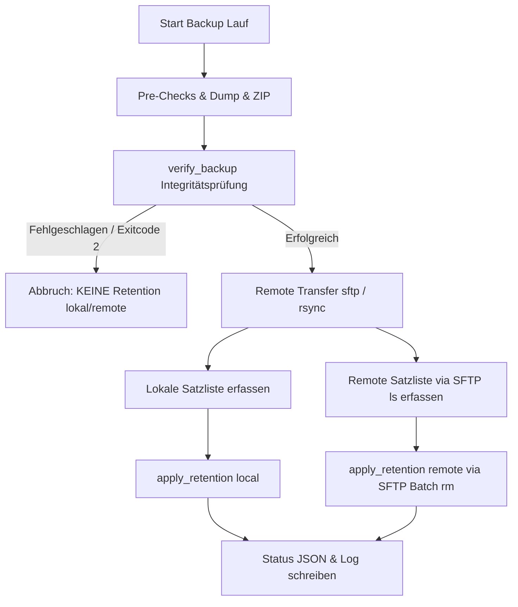

# Requirements

### Overview & Goals
Erweiterung des Backup-Skripts `backup_full_db_files_zip.sh` um eine konfigurierbare, intelligente Aufbewahrungsrichtlinie (Retention) nach dem **Großvater-Vater-Sohn-Prinzip (GVS / Staffel-Prinzip)** für lokale und entfernte Backups (SFTP/Rsync).

Das System löst die bisherige starre Lebenszeitbereinigung (`BACKUP_LIVE_TIME`) ab, bleibt jedoch **vollständig abwärtskompatibel** zu allen bestehenden Projekten und Konfigurationen ohne stilles Umstellen.

### Scope
- **In Scope:**
  - Konfigurationsparameter in `.env.<projekt>`: `RETENTION_MODE`, `KEEP_DAILY_DAYS`, `KEEP_WEEKLY_DAYS`, `KEEP_MONTHLY_DAYS`, `KEEP_MIN_SETS`, `RETENTION_REMOTE`.
  - Abwärtskompatibles Standardverhalten (`tage` wenn `BACKUP_LIVE_TIME > 0`, sonst `aus`).
  - Atomare Satzbildung (Datenbanken + Dateien eines Zeitstempels gehören zusammen und werden nur gemeinsam behalten oder gelöscht).
  - Auslesen des Zeitstempels direkt aus dem Dateinamen (unabhängig von Dateisystem-`mtime`).
  - Strikte Sicherheitsbarrieren (Löschverbot bei fehlgeschlagenem Backup / fehlgeschlagener Selbstprüfung, garantierter Mindestbestand, Schutz fremder Dateien und fremder Verzeichnisse).
  - Lokale und entfernte Bereinigung über SFTP-Batch-Befehle (auch für Rsync-Ziele über dieselben Host-/Schlüsseldaten).
  - Neuer CLI-Modus `--retention-dry-run [--project=<name>|alle]` zur gefahrlosen Vorschau und Tabellenausgabe.
  - Neuer Menüpunkt im interaktiven Hauptmenü "Aufbewahrung prüfen/einstellen" inkl. Konvertierungsfunktion nach `staffel` mit Backup (`.env.<projekt>.bak`).
  - Detailliertes Logging und Erweiterung des maschinenlesbaren Status-JSON (`status/<PROJEKT>.last.json`).
  - Testsuite mit synthetischen Testdaten über 400 Tage und Grenzfällen.
  - Aktualisierung von `.env.example`, `CHANGELOG.md` und `ROADMAP.md`.
- **Out of Scope:**
  - Modifikation von `update_wp.sh` (arbeitet weiterhin transparent mit dem Backup-Skript zusammen).
  - Direkte Manipulation von ZFS-Snapshots auf Zielservern (wird durch Remote-Dateibereinigung abgedeckt).

### User Stories
- **Als Administrator** möchte ich tägliche Backups der letzten 30 Tage, wöchentliche Backups bis 90 Tage und monatliche Backups bis 365 Tage behalten, damit ich Speicherplatz auf Server und Storage Box spare und dennoch historische Stände verfügbar habe.
- **Als Administrator** möchte ich mit `--retention-dry-run` vorab genau sehen, welche lokalen und entfernten Backup-Sätze gelöscht oder behalten werden und wie viel Speicherplatz freigegeben wird.
- **Als Administrator** möchte ich bestehende Projekte interaktiv im Menü auf das Staffel-Prinzip umstellen können, wobei meine bisherige `.env` automatisch gesichert wird.
- **Als Administrator** möchte ich die Gewissheit haben, dass bei einem fehlerhaften Backup-Lauf niemals ältere funktionierende Backups gelöscht werden.

### Functional Requirements
1. **Konfigurationsvariablen in `.env.<projekt>`:**
   - `RETENTION_MODE='tage'|'staffel'|'aus'`
   - `KEEP_DAILY_DAYS=30` (alle Backups der letzten N Tage)
   - `KEEP_WEEKLY_DAYS=90` (danach bis N Tage: jüngstes Backup je ISO-Kalenderwoche `YYYY-Www`)
   - `KEEP_MONTHLY_DAYS=365` (danach bis N Tage: jüngstes Backup je Kalendermonat `YYYY-MM`; `0` = unbegrenzt)
   - `KEEP_MIN_SETS=3` (immer mindestens N jüngste erfolgreiche Sätze schützen)
   - `RETENTION_REMOTE='yes'` (`'yes'`/`'no'`, Anwendung auf Remote-Ziel)
2. **Abwärtskompatibilität:**
   - Fehlt `RETENTION_MODE`: automatischer Fallback auf `'tage'`, wenn `BACKUP_LIVE_TIME > 0`, sonst `'aus'`.
   - Einmaliger Hinweis im Log pro Lauf, dass `'staffel'` verfügbar ist (wenn `RETENTION_MODE != 'staffel'`).
   - Setup-Assistent schlägt für neue Projekte standardmäßig `'staffel'` mit empfohlenen Vorgaben vor.
3. **Satzlogik & Konsistenz:**
   - Satz = alle Dateien mit identischem Zeitstempel `<basis>_<YYYY-MM-DD_HH-MM-SS>_*`.
   - Ein Satz gilt als "erfolgreich", wenn alle erwarteten Komponenten (`DB_COUNT` Datenbanken + ggf. `files.zip`) vorhanden sind.
   - Unvollständige Sätze, die älter als 7 Tage sind, werden gelöscht, sofern mindestens ein neuerer erfolgreicher Satz existiert.
4. **Sicherheitsregeln:**
   - Keine Löschung (weder lokal noch remote), wenn `project_exitcode == 2` oder `verify_backup` fehlgeschlagen ist.
   - Mindestens `KEEP_MIN_SETS` erfolgreiche Sätze bleiben zwingend erhalten.
   - Fremddateien (`.htaccess`, Skripte, andere Projekte) werden ignoriert.
   - Remote-Fehler erzeugen eine Warnung (`Exitcode 1`), führen aber nie zum Abbruch oder Status "Fehler" des Backups.
5. **Bedienung & Status:**
   - `--retention-dry-run [--project=<name>|alle]` zeigt tabellarische Auswertung ohne Änderungen.
   - Hauptmenü-Option zur Prüfung und Umstellung einzelner oder aller Projekte mit `.bak`-Sicherung.
   - Erweiterung des Status-JSON um `retention`.

# Technical Design

### Current Implementation
- `backup_full_db_files_zip.sh` löscht lokale Dateien bisher primitiv über `find -mtime +$backup_live_time -delete` (Zeile 2657-2663) und entfernt lokale Dateien sofort bei `DELETE_IF_TRANSMITTED=true` (Zeile 2644-2654).
- Remote-Löschung ist im Hauptskript bisher nicht implementiert (lediglich ein TODO in `backup_sync_proxy_[projectname].sh`).
- Jeder DB-Dump und das Datei-Archiv generierten bisher teils leicht zeitversetzte Zeitstempel über separate `date`-Aufrufe.

### Key Decisions
1. **Einheitlicher Lauf-Zeitstempel (`BACKUP_RUN_TIMESTAMP`):**
   - *Entscheidung:* Zu Beginn jedes Projektlaufs wird ein fester Zeitstempel `BACKUP_RUN_TIMESTAMP="$(date +%Y-%m-%d_%H-%M-%S)"` gesetzt und für alle DB-Dumps sowie das Datei-ZIP dieses Laufs verwendet.
   - *Rationale:* Garantiert atomare Backup-Sätze, die über denselben Zeitstempel eindeutig identifizierbar sind.
2. **Entscheidungs-Engine getrennt von Dateisystem-Operationen:**
   - *Entscheidung:* `evaluate_retention_sets` arbeitet rein deklarativ auf einer übergebenen Satzliste und liefert für jeden Satz ein Urteil (`BEHALTEN` / `LOESCHEN` samt Begründungscode).
   - *Rationale:* Ermöglicht denselben Algorithmus für lokale Verzeichnisse, Remote-SFTP-Listings, den Dry-Run und automatisierte Tests.
3. **Remote-Kommunikation via SFTP-Batch:**
   - *Entscheidung:* Auch für Rsync-Ziele wird für Listing (`ls -l`) und Löschung (`rm`) SFTP über dieselben SSH-Zugangsdaten (Host, Port, User, Key) verwendet.
   - *Rationale:* Vermeidet komplexe Remote-Shell-Befehle und nutzt das bereits etablierte Batchfile-Pattern.

### Architecture Diagram



### Proposed Changes & Function Design

#### 1. Konfiguration in `.env.<projekt>`
```bash

# Aufbewahrungsregeln (Retention / Großvater-Vater-Sohn)

RETENTION_MODE='staffel'   # 'staffel' | 'tage' | 'aus'
KEEP_DAILY_DAYS=30         # Alle Backups der letzten 30 Tage behalten
KEEP_WEEKLY_DAYS=90        # Bis 90 Tage: 1 Backup pro ISO-Woche (jüngstes der Woche)
KEEP_MONTHLY_DAYS=365      # Bis 365 Tage: 1 Backup pro Monat (jüngstes des Monats; 0 = unbegrenzt)
KEEP_MIN_SETS=3            # Mindestens die 3 jüngsten erfolgreichen Sätze immer behalten
RETENTION_REMOTE='yes'     # Aufbewahrungsregel auch auf dem Fernziel anwenden ('yes'/'no')
```

#### 2. Funktionsstruktur
- `parse_backup_filename(filename, project_basis)`:
  Extrahiert Zeitstempel `YYYY-MM-DD_HH-MM-SS`, Typ (`db` / `files`), DB-Name.
- `group_backup_sets(file_list_with_sizes, project_basis, expected_dbs, scope)`:
  Fasst Dateien nach Zeitstempel zusammen, ermittelt Gesamtgröße und prüft Vollständigkeit.
- `evaluate_retention_sets(sets_array, mode, daily_days, weekly_days, monthly_days, min_sets)`:
  - Berechnet Alter in Tagen anhand des Satz-Zeitstempels (ISO-Sekunden vs. Referenzzeit).
  - Ermittelt ISO-Kalenderwoche (`date -d ... +%Y-W%V` bzw. portables POSIX/AWK-Äquivalent für macOS/Linux).
  - Ermittelt Kalendermonat (`YYYY-MM`).
  - Weist Entscheidungen zu:
    - Alter $\le$ `KEEP_DAILY_DAYS` $\rightarrow$ `BEHALTEN (taeglich)`
    - Alter $\le$ `KEEP_WEEKLY_DAYS` $\rightarrow$ jüngster Satz der ISO-Woche $\rightarrow$ `BEHALTEN (woechentlich)`
    - Alter $\le$ `KEEP_MONTHLY_DAYS` (oder `KEEP_MONTHLY_DAYS == 0`) $\rightarrow$ jüngster Satz des Monats $\rightarrow$ `BEHALTEN (monatlich)`
    - Rang $\le$ `KEEP_MIN_SETS` unter erfolgreichen Sätzen $\rightarrow$ `BEHALTEN (minimum)`
    - Unvollständig und Alter $> 7$ Tage und neuere erfolgreiche Sätze vorhanden $\rightarrow$ `LOESCHEN (unvollstaendig_alt)`
    - Sonst $\rightarrow$ `LOESCHEN (zu_alt)`
- `apply_retention(target_location, project_env_file, is_dry_run)`:
  - Führt die Bereinigung für `local` bzw. `remote` aus.
  - Schreibt Log-Einträge: `[RETENTION][LOKAL|REMOTE] Lösche Satz 2025-10-12_03-00-00 (Grund: zu_alt, 3 Dateien, 142 MB)`.
  - Liefert Zähler und freigegebene Bytes für Status-JSON zurück.

#### 3. Status JSON Schema Erweiterung
```json
"retention": {
  "modus": "staffel",
  "lokal": {
    "behalten": 14,
    "geloescht": 2,
    "frei_bytes": 154829100
  },
  "remote": {
    "behalten": 14,
    "geloescht": 2,
    "frei_bytes": 154829100,
    "fehler": null
  }
}
```

#### 4. Dry-Run & Interaktive Menüerweiterung
- CLI: `--retention-dry-run [--project=<name>|alle]`
- Menüpunkt 9 (oder Unterpunkt): "Aufbewahrung prüfen / einstellen (Staffel/GVS)":
  1. Zeigt formatierte Tabelle aller Sätze lokal & remote mit Spalten: `Zeitstempel`, `Umfang`, `Dateien`, `Größe`, `Status`, `Entscheidung`, `Grund`.
  2. Bietet Aktion an: `Projekt(e) auf 'staffel' umstellen (erstellt .env.<projekt>.bak)`.

# Testing

### Validation Approach
Die Validierung erfolgt automatisiert und skriptgesteuert über eine dedizierte Bash-Testsuite mit künstlichen Testdaten ohne Belastung von Produktivsystemen sowie über manuelle CLI- und Menütests.

### Key Scenarios
1. **Großvater-Vater-Sohn 400-Tage-Verteilung:**
   - Erstellung synthetischer Backup-Sätze (leere ZIP/SQL-Dateien mit validen Zeitstempeln) über 400 Tage hinweg.
   - Prüfung:
     - Letzte 30 Tage: alle täglichen Sätze werden behalten.
     - Tag 31 bis 90: genau 1 Satz pro Kalenderwoche bleibt erhalten.
     - Tag 91 bis 365: genau 1 Satz pro Kalendermonat bleibt erhalten.
     - Älter als 365 Tage: wird zur Löschung markiert.
2. **Sicherheitsbarriere bei Backup-Fehlschlag:**
   - Backup-Lauf schlägt fehl (`exitcode=2` / simulierte defekte SQL/ZIP-Datei).
   - Prüfung: Retention wird komplett übersprungen; weder lokale noch Remote-Dateien werden angetastet.
3. **Mindestbestandsschutz (`KEEP_MIN_SETS`):**
   - Projekt mit z. B. nur 2 alten Backups (Alter 120 Tage).
   - Prüfung: Trotz Überschreiten von `KEEP_DAILY_DAYS` werden beide Sätze wegen `KEEP_MIN_SETS=3` behalten (`Grund: minimum`).
4. **Behandlung unvollständiger Sätze:**
   - Satz mit DB-Dump, aber fehlendem `files.zip` älter als 7 Tage.
   - Prüfung: Satz wird als unvollständig erkannt und gelöscht (`Grund: unvollstaendig_alt`), wenn neuere vollständige Sätze existieren.
   - Unvollständiger Satz jünger als 7 Tage bleibt vorerst erhalten.
5. **Schutz fremder Dateien:**
   - Ordner enthält `.htaccess`, `andere_datei.txt` und Dateien eines anderen Projekts `projektB_2026-01-01_*.zip`.
   - Prüfung: Nur Dateien des aktuellen Projekts werden erfasst; Fremddateien bleiben unberührt.
6. **Remote-Fehler-Toleranz:**
   - SFTP-Ziel offline oder falscher Schlüssel für Remote-Aufräumen.
   - Prüfung: Warnung im Log und im JSON (`retention.remote.fehler`), Exit-Code maximal 1, kein Abbruch des Backups.
7. **Abwärtskompatibilität bestehender `.env`:**
   - `.env` ohne `RETENTION_MODE` und `BACKUP_LIVE_TIME=0` $\rightarrow$ Modus `aus`, keine Löschung, Hinweis im Log.
   - `.env` ohne `RETENTION_MODE` und `BACKUP_LIVE_TIME=14` $\rightarrow$ Modus `tage`, Löschung nach 14 Tagen.
8. **Dry-Run & Konvertierung:**
   - Aufruf von `--retention-dry-run` erzeugt reine Vorschautabelle ohne Dateisystemänderungen.
   - Menü-Umstellung auf `staffel` erzeugt `.env.<projekt>.bak` mit exaktem Inhalt des Originals.

# Delivery Steps

### ✓ Step 1: Kernlogik für Satzbildung und GVS-Retention-Algorithmus implementieren
Ergebnis: Das Skript verfügt über robuste Hilfsfunktionen zur Extraktion von Zeitstempeln aus Dateinamen, zur Gruppierung von Backup-Sätzen und zur simulationsfreien Bestimmung der Behalteentscheidung nach dem Großvater-Vater-Sohn-Prinzip.

- Zeitstempel-Parser implementieren (`parse_backup_filename`), der Basisname, Datum (`YYYY-MM-DD_HH-MM-SS`), Typ (`db` / `files`) und DB-Name isoliert.
- Satzbildungs-Logik (`group_backup_sets`) entwickeln, die alle zugehörigen Dateien desselben Zeitstempels zusammenfasst und die Vollständigkeit anhand erwarteter DB- und Datei-Artefakte prüft.
- Berechnungs- und Entscheidungslogik `apply_retention_rules` implementieren:
  - Zuordnung zu Täglichen (`KEEP_DAILY_DAYS`), Wöchentlichen (`KEEP_WEEKLY_DAYS`, jüngster Satz der ISO-Kalenderwoche) und Monatlichen Backups (`KEEP_MONTHLY_DAYS`, jüngster Satz des Kalendermonats).
  - Berücksichtigung des Mindestbestands (`KEEP_MIN_SETS`), unvollständiger Sätze (> 7 Tage) und von `RETENTION_MODE` (`staffel`, `tage`, `aus`).
  - Rückgabe strukturierter Entscheidungslisten mit Status (`behalten`/`geloescht`), Grund (`taeglich`, `woechentlich`, `monatlich`, `minimum`, `unvollstaendig_alt`, `zu_alt`, `tage_abgelaufen`) und Speichergrößen.

### ✓ Step 2: Lokale und Remote-Bereinigung (SFTP/Rsync) mit Sicherheitsregeln umsetzen
Ergebnis: Lokale und entfernte Backup-Bestände werden nach Sicherheitsprüfung bereinigt; Remote-Löschungen laufen fehlerresistent über SFTP-Batch-Kommandos.

- Lokale Retention-Ausführung (`apply_retention_local`) implementieren, die lokale Sätze prüft, protokoliert und gelöschte Dateien via `rm -f` entfernt.
- Remote Retention-Ausführung (`apply_retention_remote`) implementieren:
  - Remote-Dateiliste und -Größen über SFTP-Batch (`ls -l` / `ls -1`) abfragen.
  - Sätze bilden, Retention anwenden und Löschbefehle per SFTP-Batch (`rm`) ausführen (auch für rsync-Ziele unter Nutzung derselben SSH/SFTP-Zugangsdaten).
  - Fehler beim Remote-Aufräumen isolieren, als Warnung im Log und Status-JSON erfassen, ohne den Haupt-Backup-Lauf fehlschlagen zu lassen (Exitcode maximal 1).
- Zwingende Sicherheitsbarrieren einziehen:
  - Sofortiger Abbruch und Löschverbot, wenn der aktuelle Lauf nicht erfolgreich war (`exitcode == 2` oder Selbstprüfung `verify_backup` fehlgeschlagen).
  - Schutz von `.htaccess`, Skripten, Fremddateien und anderen Projekten.
  - Strikte Begrenzung auf das konfigurierte Projekt-Zielverzeichnis.

### ✓ Step 3: Integration in Backup-Lifecycle, Status-JSON und Setup-Assistent
Ergebnis: Der Backup-Lauf führt die Aufbewahrungsregeln nach erfolgreicher Verifikation und Übertragung aus, erfasst die Ergebnisse im Status-JSON, und der Setup-Assistent sowie das Hauptmenü unterstützen 'staffel'.

- Retention-Aufruf in `run_backup_for_project` nach `verify_backup` und Übertragung einbinden (bei `DELETE_IF_TRANSMITTED=true` nur remote).
- Log-Meldungen pro Löschung (Ort, Datei, Grund) sowie einmaligen Hinweis pro Lauf ausgeben, wenn `staffel` noch nicht aktiv ist.
- `status/<PROJEKT>.last.json` um das Feld `retention` mit `modus`, `lokal` (behalten, geloescht, frei_bytes) und `remote` (behalten, geloescht, frei_bytes, fehler) erweitern.
- Setup-Assistent (`run_setup_assistant`) und `write_project_env_file` um `RETENTION_MODE='staffel'`, `KEEP_DAILY_DAYS=30`, `KEEP_WEEKLY_DAYS=90`, `KEEP_MONTHLY_DAYS=365`, `KEEP_MIN_SETS=3`, `RETENTION_REMOTE='yes'` erweitern.
- `.env.example` aktualisieren und Abwärtskompatibilität für bestehende `.env`-Dateien (`tage` bei `BACKUP_LIVE_TIME > 0`, sonst `aus`) garantieren.

### * Step 4: Dry-Run, Hauptmenü-Steuerung, Tests und Dokumentation
Ergebnis: Dry-Run-Funktionalität auf CLI- und Menüebene verfügbar, Migration bestehender Projekte möglich, Testsuite und Dokumentation vollständig.

- CLI-Parameter `--retention-dry-run [--project=<name>|alle]` implementieren mit tabellarischer Ausgabe (Datum, Typ, Größe, Entscheidung, Grund, freiwerdender Speicherplatz lokal/remote).
- Menüpunkt "Aufbewahrung prüfen/einstellen" im interaktiven Hauptmenü integrieren:
  - Anzeige des Dry-Runs für das gewählte oder alle Projekte.
  - Interaktive Umstellung auf `RETENTION_MODE='staffel'` mit automatischer Sicherung der alten `.env` als `.env.<projekt>.bak`.
  - Batch-Umstellung aller Projekte nach Bestätigung.
- Synthetische Testsuite für Testfälle erstellen (400-Tage-Staffelung, fehlgeschlagener Lauf, unvollständige Sätze, Mindestsätze, Fremddateien, Remote-Fehler, Alt-Konfigurationen).
- `ROADMAP.md` (Ergänzung in Etappe 2 / Detail-Abschnitt zur Retention) und `CHANGELOG.md` aktualisieren.