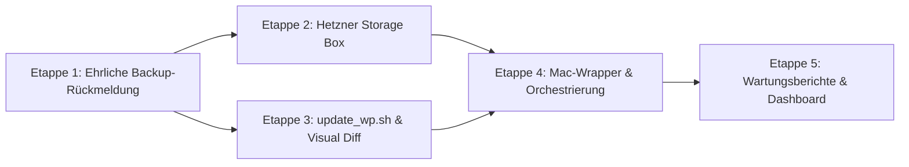

# Requirements

### Overview & Goals
Ziel ist die Erstellung einer umfassenden, strukturierten und entwicklungsfertigen `ROADMAP.md` im Repository. Diese Roadmap definiert den Ausbau des bewährten Shell-Backup-Skripts `backup_full_db_files_zip.sh` zu einer schlanken, autarken und leicht zu wartenden Wartungs-Toolchain für WordPress-Kundeninstanzen auf Shared-Hosting-Servern.

### Scope
- **In Scope:**
  - Erstellung der Datei `ROADMAP.md` nach den Vorgaben der Aufgabenstellung.
  - Vollständige **Ist-Analyse** des bestehenden Codes (`backup_full_db_files_zip.sh`, `update_wp.sh`, `CHANGELOG.md`, `README.md`) mit konkreten Funktions- und Zeilenreferenzen, Fehlerbehandlung, Sicherheitsmodell und technischen Schulden.
  - Detaillierte Spezifikation von **5 in sich geschlossenen Etappen**:
    1. Ehrliche Rückmeldung & Selbstprüfung des Backup-Scripts
    2. Sichere Offsite-Ablage auf Hetzner Storage Box (Briefkasten-Prinzip)
    3. Autarkes WordPress-Update-Script `update_wp.sh` mit visueller Regressionsprüfung
    4. Lokales Mac-Orchestrierungs- und Prüfskript
    5. Kundenübersicht & monatliche Wartungsberichte
  - Vollständiges Steckbrief-Format für jede Etappe (Ziel/Nutzen, Checkliste `- [ ]`, Dateien/Funktionen, Abnahmekriterien, Testplan mit Fehlerfällen, Risiken/Kompatibilität, Aufwand S/M/L).
  - Querschnittskapitel: Rollout-Strategie, Offene Entscheidungen, Nicht im Umfang (Out of Scope mit Begründungen).
- **Out of Scope (für diesen Schritt):**
  - Keine Implementierung von neuem Produktivcode in den Skripten (erst Analyse und Erstellung der Roadmap).

### User Stories
- **Als Webentwickler & Systembetreuer (Gregor):**
  - Möchte ich eine klare, verbindliche Roadmap besitzen, um Weiterentwicklungen etappenweise, risikolos und ohne Regression bestehender Kunden-Installationen durchzuführen.
  - Möchte ich "Mensch in der Schleife" bleiben und Wartungsläufe gezielt per SSH oder vom Mac aus steuern, während Routineaufgaben und Prüfungen vollautomatisch ablaufen.
  - Möchte ich für jedes Projekt auf Shared Hosting (ohne Root/sudo) eine sichere, isolierte Offsite-Sicherung auf Hetzner Storage Boxen mit ZFS-Snapshots einrichten können.
  - Möchte ich WordPress-Updates inklusive visueller Regressionsprüfung und automatischem Rollback-Plan durchführen, um defekte Plugins und Layout-Brüche sofort zu erkennen.

### Core Constraints
- **Shared Hosting:** Kein Root, kein sudo, kein Daemon, ausschließlich Standard-Tools (Bash 4+, `curl`/`wget`, `unzip`, `grep`, `sed`, `awk`, `find`, PHP-CLI).
- **Abwärtskompatibilität:** Bestehende `.env.<projekt>`-Dateien, Verzeichnisstrukturen und Cronjobs müssen ohne Unterbrechung weiter funktionieren.
- **Autarkie:** Keine zwingenden externen Laufzeit-Bibliotheken; Skripte arbeiten eigenständig oder rufen sich direkt auf.
- **Sicherheit:** `umask 077`, `chmod 600/700`, Webroot-Schutz `.htaccess`, keine Passwörter in Logs oder CLI-Parametern.

# Technical Design

### Current Implementation & Codebase Findings

Die Ist-Analyse in `ROADMAP.md` stützt sich auf die reale Codebasis:

1. **Skript-Architektur `backup_full_db_files_zip.sh`:**
   - **Modularer Aufbau:** Hilfsfunktionen für JSON-Escaping (`json_escape`), Speichernormalisierung (`get_file_size_bytes`, `check_disk_space`), Webroot-Schutz (`ensure_webroot_protection`), `wp-config.php`-Parser (`parse_wp_config_file`), Pre-Checks (`run_pre_backup_checks`), Backup-Routinen (`backup_db`, `backup_files`), Selbstprüfung (`verify_backup`), interaktiver Restore (`interactive_restore_db`), Setup-Assistent (`run_interactive_wizard`, `scan_and_setup_wordpress_projects`) und Menüsteuerung (`show_main_menu`).
   - **Konfigurationsmodell:** Pro Projekt eine `.env.<projektname>` mit Berechtigungen `0600` (Multi-DB via `DB_COUNT`, `DB_n_*`).
   - **Ablage:** Backups unter `./backup/<projekt>/`, Logs unter `./log/`, maschinenlesbare Statusdaten unter `./status/<projekt>.last.json`.

2. **Fehlerbehandlung & Signalfluss:**
   - Explizite Exitcodes: `0` (Erfolg), `1` (Warnungen, z. B. Remote-Transfer fehlgeschlagen, lokales Backup intakt, Größenabweichung > 30 %), `2` (kritischer Fehler bei DB-Dump oder ZIP-Archivierung).
   - Bei `--project=alle` wird über `worst_exit_code` der schwerwiegendste Fehlercode zurückgegeben, während alle Projekte sequenziell abgearbeitet werden.
   - Maschinenlesbarer JSON-Export via `--json` auf `stdout` (Logs auf `stderr`).

3. **Sicherheitsanalyse:**
   - Sensible Zugangsdaten liegen in `.env.<projekt>` geschützt mit `chmod 600`.
   - Automatischer Apache 2.4/2.2 `.htaccess`-Schutz sperrt den Webroot-Zugriff auf Skripte, Logs und Backups.
   - `DELETE_IF_TRANSMITTED` löscht lokale Backups nach erfolgreichem SFTP/Rsync-Transfer.

4. **Bestehendes `update_wp.sh` & Visuelle Regression:**
   - Autarkes Update-Skript mit WP-CLI-Selbstinstallation (`./bin/wp-cli.phar`), Pre-Checks, automatischem Backup-Vorschalt-Schritt, visueller Regressionsprüfung (XML-Sitemap-Extraktion, Vorher/Nachher-Screenshots via `mshots` oder lokale Headless-Browser, ImageMagick- bzw. PHP-GD-Differenzberechnung), Ampel-Bewertung (GRÜN/GELB/ROT) und `rollback.sh`-Generierung.

---

### Gliederung & Inhalte der `ROADMAP.md`

Die Datei `ROADMAP.md` wird wie folgt strukturiert:

```markdown

# Roadmap: WordPress Backup & Maintenance Toolchain #

## 1. Ausgangslage & Ist-Analyse
- Aufbau der bestehenden Skripte und Komponenten
- Signal- und Fehlerbehandlung (Exitcodes, Logs, JSON-Status)
- Sicherheitsmodell (Dateirechte, Webroot-Schutz, Zugangsdaten)
- Technische Schulden & identifizierte Risiken

## 2. Leitlinien & Architekturprinzipien
- Mensch in der Schleife (SSH / Mac-CLI)
- Shared-Hosting-Tauglichkeit (kein Root/sudo, nur Standard-Tools)
- Einfache Verwaltung vor Überkomplexität (Self-Contained)
- Striker Erhalt der Abwärtskompatibilität

## 3. Die 5 Etappen der Roadmap
- Etappe 1: Ehrliche Rückmeldung & Backup-Selbstprüfung
- Etappe 2: Sichere Ablage auf Hetzner Storage Box (Briefkasten-Prinzip)
- Etappe 3: WordPress-Update-Script mit visueller Regression
- Etappe 4: Lokaler Mac-Prüf-Wrapper & Orchestrierung
- Etappe 5: Multi-Projekt-Dashboard & Kunden-Wartungsberichte

## 4. Rollout- & Betriebsstrategie
- Versionierung & Changelog-Pflege
- Bereitstellung auf Kundenservern
- Versionsprüfungen bei Laufzeitstart

## 5. Offene Entscheidungen & Fragen vor den Etappen
- Offene Punkte für Storage-Box-Provisionierung, Mac-Tooling und Berichtsausgabe

## 6. Nicht im Umfang (Out of Scope)
- Bewusst ausgeschlossene Architekturen (zentraler Kontrollserver, asynchrone Queues, age-Verschlüsselung) inkl. Begründung und Kriterien für spätere Neubewertung
```

---

### Detailspezifikation der 5 Etappen

Jede Etappe erhält in `ROADMAP.md` einen identischen, vollständigen Steckbrief:



1. **Etappe 1 – Ehrliche Rückmeldung des Backup-Scripts:**
   - **Ziel & Nutzen:** Zuverlässige automatisierte Statusbewertung ohne manuelle Log-Inspektion.
   - **Checkliste:** Exitcodes 0/1/2, `verify_backup` (unzip-Test, Header/Footer, Tabellen, 30%-Größencheck), `status/<projekt>.last.json`, CLI-Optionen `--json` und `--quiet`.
   - **Dateien:** `backup_full_db_files_zip.sh`, `README.md`, `CHANGELOG.md`.
   - **Abnahme:** Exitcodes spiegeln tatsächlichen Zustand; fehlerhafte Dumps brechen mit Exit 2 ab; JSON ist valide.
   - **Aufwand:** M.

2. **Etappe 2 – Sichere Ablage auf Hetzner Storage Box (Briefkasten-Prinzip):**
   - **Ziel & Nutzen:** Isolierte, manipulationssichere Offsite-Backups pro Kunde mit Snapshot-Schutz.
   - **Checkliste:** Dedizierte Unterkonten, schlüssellose ed25519-Keys (Port 23, OpenSSH, chmod 600) im Setup-Wizard, SSH-Verbindungstest, ZFS-Snapshot-Dokumentation (`/.zfs/snapshot`), Warnung bei `DELETE_IF_TRANSMITTED` ohne bestätigte Snapshots, Migrations-Leitfaden.
   - **Dateien:** `backup_full_db_files_zip.sh`, `.env.example`, `README.md`.
   - **Abnahme:** Setup erzeugt Schlüssel und validiert Verbindung zur Storage Box; Snapshots schützen vor Löschung bei Serverkompromittierung.
   - **Aufwand:** M.

3. **Etappe 3 – Update-Script `update_wp.sh` & Visuelle Regression:**
   - **Ziel & Nutzen:** Risikolose WordPress-Aktualisierungen mit automatischem Backup-Schutz, visueller Differenzprüfung und Notfall-Rollback.
   - **Checkliste:** WP-CLI-Bereitstellung nach `./bin/` mit SHA-512, Vorprüfungen (Maintenance, HTTP 200, Must-Contain), Backup-Kopplung, Screenshot-Erfassung (Sitemap-Sampling via mshots/Local), Differenzberechnung (ImageMagick/PHP-GD), Ampel-System (GRÜN/GELB/ROT), `rollback.sh`-Erstellung, `--json`-Export.
   - **Dateien:** `update_wp.sh`, `.update.example`, `README.md`, `CHANGELOG.md`.
   - **Abnahme:** Updates brechen bei defektem Backup sicher ab; fehlerhafte Plugins lösen ROT und Rollback-Befehle aus; Screenshots decken Layout-Fehler auf.
   - **Aufwand:** L.

4. **Etappe 4 – Prüfung von außen (Mac-Wrapper-Script):**
   - **Ziel & Nutzen:** Bequeme Ein-Klick-Aktualisierung mehrerer Kundenseiten vom lokalen Entwicklungsrechner aus.
   - **Checkliste:** Lokales Bash/Node-Skript für macOS, Parsing einer Kunden-Inventarliste, SSH-Fernaufruf mit `--json`, lokaler BackstopJS/Playwright-Screenshot-Vergleich als Zweitprüfung, farbige Zusammenfassungsmatrix im Terminal.
   - **Dateien:** `mac/wp_maintain.sh` (oder `tools/remote_update.sh`), `tools/clients.example.json`.
   - **Abnahme:** Ein Aufruf iteriert über ausgewählte Kunden, meldet Statuscodes und visualisiert Ergebnisse lokal.
   - **Aufwand:** M.

5. **Etappe 5 – Übersicht & Wartungsberichte:**
   - **Ziel & Nutzen:** Transparente Dokumentation der Wartungsarbeiten für Kunden und interne Übersicht aller Installationen.
   - **Checkliste:** Generator für statische HTML/Markdown-Dashboards aus `.last.json` und `update-runs/`, Vorlage für monatliche Kundenberichte (aktualisierte Komponenten, Prüfergebnisse, Backup-Status).
   - **Dateien:** `tools/generate_report.sh`, Vorlagen unter `templates/report_monthly.md`.
   - **Abnahme:** Generiert vollständige Kundenübersicht und versandfertige Monatsberichte auf Knopfdruck.
   - **Aufwand:** S.

# Testing

### Validation Approach
Die Validierung der erstellten `ROADMAP.md` erfolgt durch Prüfung der Vollständigkeit, Widerspruchsfreiheit und Ausführbarkeit anhand der Aufgabenstellung:

1. **Strukturelle & Inhaltliche Vollständigkeit:**
   - Alle in der Problemstellung geforderten Abschnitte (Ausgangslage/Ist-Analyse, Ziele, 5 Etappen mit allen Detailpunkten, Rollout, Offene Entscheidungen, Nicht im Umfang) sind vollständig enthalten.
   - Jede Etappe enthält Ziel & Nutzen, Aufgaben-Checkliste (`- [ ]`), betroffene Dateien, Abnahmekriterien, Testplan inkl. Fehlerfälle, Risiken und Aufwandsschätzung.

2. **Konsistenz mit der Codebasis:**
   - Alle referenzierten Funktionen, CLI-Flags, Konfigurationsparameter und Dateipfade stimmen exakt mit dem bestehenden Code in `backup_full_db_files_zip.sh` und `update_wp.sh` überein.
   - Technische Schulden und Sicherheitsmechanismen sind mit korrekten Zeilenbereichen und Funktionsnamen belegt.

3. **Formatierung & Lesbarkeit:**
   - Korrektes Markdown-Format mit konsistenten Überschriftenebenen, Code-Blöcken, Checklisten und Mermaid-Diagrammen.

### Testplan für die Etappen (in ROADMAP.md verankert)
- **Defektes Backup / DB-Fehler:** Simulierter Abbruch von `mysqldump` oder ungültige ZIP-Dateien führen reproduzierbar zu Exitcode 2 und stoppen nachfolgende Updates.
- **Remote-Transfer-Fehler:** Nicht erreichbare Storage Box oder falsche SSH-Keys führen zu Exitcode 1 (lokale Sicherung intakt).
- **Visuelle Fehler / Broken Layout:** Defektes Plugin oder CSS-Fehler erzeugen Screenshot-Abweichungen $> 20\,\%$ und führen zu Ampel ROT inkl. `rollback.sh`.
- **Headless- / Cron-Betrieb:** Ausführung ohne TTY (per SSH / Cronjob) läuft unterbrechungsfrei ohne interaktive Abfragen durch.

# Delivery Steps

### ✓ Step 1: Ist-Analyse und Architektur-Grundlagen in ROADMAP.md verfassen
Vollständige Erfassung der aktuellen Architektur und des Ist-Zustands im neuen Dokument `ROADMAP.md`.

- Erstellen der Datei `ROADMAP.md` mit Kopfbereich, Zielsetzung und Rahmenbedingungen (Shared Hosting, Mensch in der Schleife, Abwärtskompatibilität).
- Dokumentation des aktuellen Script-Aufbaus von `backup_full_db_files_zip.sh` (Funktionen, Menüführung, CLI-Parameter, `.env.<projekt>`-Schema, Dateiablage unter `backup/`, `log/`, `status/`).
- Analyse der aktuellen Signal- und Fehlerbehandlung (Exitcodes 0/1/2, Log-Protokollierung, historische und verbleibende Fehlerschluckstellen).
- Sicherheitsanalyse (Ablage von Zugangsdaten mit chmod 600, Webroot-Schutz `.htaccess`, Verhalten von `DELETE_IF_TRANSMITTED`, SFTP/Rsync-Verbindungen).
- Konkrete Dokumentation technischer Schulden und Risiken mit Funktions- und Zeilenreferenzen (`backup_full_db_files_zip.sh`, `update_wp.sh`).

### ✓ Step 2: Etappen 1 bis 3 (Backup-Rückmeldung, Storage Box, Update-Workflow) spezifizieren
Ausarbeitung der Kern-Etappen 1 bis 3 als umsetzbare, modulare Meilensteine mit vollständigen Spezifikationen.

- **Etappe 1 (Ehrliche Rückmeldung des Backup-Scripts):** Checkliste für Exitcodes 0/1/2, Integritäts- und Strukturselbstprüfung (`verify_backup` mit `unzip -tq`, SQL-Header/Footer, Tabellenprüfung, 30%-Größenabweichung), maschinenlesbare Status-Dateien (`status/<projekt>.last.json`), CLI-Flags `--json` und `--quiet`.
- **Etappe 2 (Hetzner Storage Box nach Briefkasten-Prinzip):** Checkliste für dedizierte Unterkonten pro Projekt/Kunde, automatisierte Erzeugung von ed25519-SSH-Schlüsseln ohne Passphrase (Port 23, OpenSSH-Format, chmod 600), interaktiver Verbindungstest im Setup, ZFS-Snapshot-Dokumentation (`/.zfs/snapshot`), Absicherung von `DELETE_IF_TRANSMITTED` mit Snapshot-Warnung und Migrationspfad von zentralen Zugängen.
- **Etappe 3 (WordPress-Update-Script & Visuelle Regression):** Checkliste für autarke Bereitstellung (`update_wp.sh`), WP-CLI-Selbstinstallation nach `./bin/` mit SHA-512-Prüfung, Projektkonfiguration `.update.<projekt>`, Sicherheitsprüfungen vorab, Verknüpfung mit dem Backup-Skript, visuelle Regressionsprüfung (Sitemap-Sampling, Screenshots via mshots/Headless, ImageMagick/PHP-GD Differenzanalyse), Post-Checks, Ampel-Bewertung (GRÜN/GELB/ROT) und automatische Generierung von `rollback.sh`.
- Für jede Etappe: Ziel & Nutzen, Checkliste (`- [ ]`), betroffene Dateien/Funktionen, Abnahmekriterien, Testplan inkl. Fehlerfällen, Risiken/Abwärtskompatibilität und Aufwandsschätzung (S/M/L).

### ✓ Step 3: Etappen 4 und 5, Rollout-Strategie und Rahmenkapitel fertigstellen
Ausarbeitung der erweiterten Werkzeuge, Orchestrierung, Berichte und strategischen Rahmenbedingungen in `ROADMAP.md`.

- **Etappe 4 (Prüfung von außen / Mac-Wrapper-Script):** Spezifikation eines lokalen Orchestrierungs- und Prüfskripts für macOS (Kundenliste, SSH-Steuerung, externe Screenshot-Validierung via BackstopJS/Playwright, interaktive Zusammenfassung).
- **Etappe 5 (Wartungsberichte & Übersicht):** Spezifikation für statische Multi-Projekt-Dashboards (HTML/Markdown) und automatisierte Kunden-Monatsberichte auf Basis der erzeugten `.last.json`- und Update-Run-Daten.
- **Rollout-Konzept:** Definition der Versionsverwaltung, Changelog-Pflege und Bereitstellungsmethoden auf Kundenservern (Versionsprüfung beim Start).
- **Offene Entscheidungen:** Dokumentation offener Architekturfragen vor den jeweiligen Etappen.
- **Nicht im Umfang:** Klare Abgrenzung gegen Over-Engineering (zentraler Server, komplexe Queue-Dienste, `age`-Verschlüsselung) mit Begründung und Schwellenwerten für spätere Re-Evaluierung.
- Konsistenzabgleich mit `README.md` und `CHANGELOG.md`.