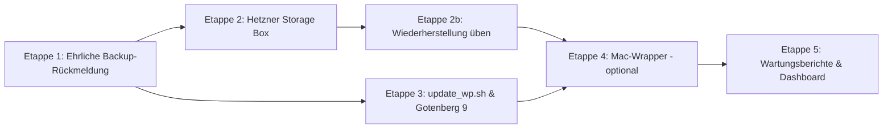

# Roadmap: WordPress Backup & Maintenance Toolchain #

Diese Roadmap definiert die strategische und technische Weiterentwicklung des bewährten Shell-Backup-Skripts `backup_full_db_files_zip.sh` zu einer schlanken, autarken und leicht zu wartenden Wartungs-Toolchain für WordPress-Kundeninstanzen auf Shared-Hosting-Servern.

---

## 1. Ausgangslage & Ist-Analyse

### 1.1 Script-Architektur & Komponenten
Die aktuelle Codebasis besteht aus zwei Hauptskripten sowie zugehörigen Konfigurations- und Protokollstrukturen:

1. **`backup_full_db_files_zip.sh` (v2.2.0):**
   - **Modularer Funktionsaufbau:**
     - *Hilfsfunktionen & Normalisierung:* `json_escape`, `json_string_array`, `get_file_size_bytes`, `normalize_scope`, `check_disk_space`, `resolve_dir_path`.
     - *Sicherheit & Webroot-Schutz:* `ensure_webroot_protection` konfiguriert `.htaccess` für Apache 2.4 (`Require all denied`) und Apache 2.2 (`Deny from all`) für sensible Dateien (`.env*`, `.update*`, `.gotenberg*`, `.git*`, `*.log`, `*.sh`, `*.json`, `*.lock`).
     - *Alarmierung & Healthchecks:* `send_healthcheck_ping` sendet Pings an Healthchecks.io (`/start` zu Beginn, `/<exitcode>` am Ende) mit 10s Timeout.
     - *Konfigurations- & WordPress-Parser:* `extract_wp_constant_sed`, `parse_wp_config_file` liest DB-Parameter (`DB_NAME`, `DB_USER`, `DB_PASSWORD`, `DB_HOST`), Tabellenpräfix (`$table_prefix`) und Website-URLs tokenbasiert ohne PHP-Ausführung aus.
     - *Pre-Checks & Integrität:* `run_pre_backup_checks` validiert `WP_DEBUG`, PHP-Error-Logs, Upload-Verzeichnis auf Webshells/PHP-Dateien (unter Auslassung harmloser Index-Platzhalter) und DB-Konnektivität.
     - *Backup & Verifikation:* `backup_db`, `backup_files` und `verify_backup` prüfen ZIP-Integrität (`unzip -tq`), SQL-Header/Footer (`mysqldump`, `-- Dump completed`), WordPress-Kerntabellen (`options`, `posts`) und 30%-Größenabweichungen.
     - *Wiederherstellung & Assistenten:* `interactive_restore_db`, `run_setup_assistant`, `scan_and_setup_wordpress_sites`, `run_main_menu`.
   - **Konfigurationsmodell:**
     - Pro Projekt eine Konfigurationsdatei `.env.<projektname>` (Berechtigung `0600`), abwärtskompatibel zu `.env` ("default"). Unterstützt Multi-DB (`DB_COUNT`, `DB_1_*` bis `DB_n_*`), `SOURCE_FILES_DIR_IGNORE`, `HEALTHCHECK_URL`, SFTP/Rsync-Fernübertragung und `DELETE_IF_TRANSMITTED`.
   - **Ablage- und Verzeichnisstruktur:**
     - Backups: `./backup/<PROJEKT_BASIS_DATEINAME>/`
     - Logs: `./log/<PROJEKT_BASIS_DATEINAME>_YYYY-MM-DD_HH-MM-SS.log`
     - Maschinenlesbarer Status: `./status/<PROJEKT_BASIS_DATEINAME>.last.json`

2. **`update_wp.sh` (v1.1.0):**
   - Autarkes Update-Skript mit WP-CLI-Integration (`./bin/wp-cli.phar` via `ensure_wp_cli`, SHA-512 Hash-Prüfung).
   - Zentrale Gotenberg-Konfiguration `.gotenberg` (chmod 600, Webroot-Schutz) für optische Regressionstests über Gotenberg 9 (`https://gotenberg.gregor-wendland.com`).
   - Projektkonfiguration `.update.<projekt>` mit Pre-Checks (Wartungsmodus, HTTP 200, `MUST_CONTAIN`), Backup-Pflicht-Kopplung an `backup_full_db_files_zip.sh`, visuellem Screenshot-Vergleich (Multi-Viewport 1440px / 390px, `waitDelay`, Cookies, Ignore-Rectangles, Differenzberechnung via ImageMagick `compare` / PHP-GD) und Ampel-Bewertung (GRÜN, GELB, ROT) inkl. automatischer `rollback.sh`-Generierung.

---

### 1.2 Signal- und Fehlerbehandlung
- **Exitcode-Konvention (einheitlich 0, 1, 2):**
  - `0` (Erfolg / GRÜN): Alle Operationen (Dumps, ZIPs, Prüfungen, Übertragungen) fehlerfrei abgeschlossen; visuelle Abweichung $< 1\,\%$.
  - `1` (Warnung / GELB): Nicht-kritische Fehler (z. B. Remote-Transfer fehlgeschlagen, lokales Backup jedoch intakt; Backup-Größenabweichung > 30 %; Antwortzeitverlangsamung; visuelle Abweichung 1–5 %; Gotenberg-Screenshot-Dienst nicht erreichbar).
  - `2` (Fehler / ROT): Kritischer Ausfall (Datenbankdump fehlgeschlagen, ZIP-Erstellung defekt, Integritätsprüfung fehlgeschlagen, Vorprüfungen nicht bestanden, Fatal Error im Log/HTML, visuelle Abweichung $> 5\,\%$).
- **Multi-Projekt-Lauf (`--project=alle`):**
  - Sequenzielle Abarbeitung aller Projekte; der schwerwiegendste Exitcode (`worst_exit_code`) bestimmt den finalen Skript-Exitcode.
- **Maschinenlesbare Schnittstelle (`--json`):**
  - Reines JSON-Objekt (bzw. JSON-Array bei `alle`) auf `stdout`, alle Benutzerhinweise, Fortschrittsmeldungen und Fehler auf `stderr`.
- **Healthchecks.io Überwachung:**
  - `backup_full_db_files_zip.sh` sendet beim Start einen `/start`-Ping und beim Beenden einen `/<exitcode>`-Ping (z. B. `/0`, `/1`, `/2`) an `HEALTHCHECK_URL`. Netzwerkfehler beeinflussen den Backup-Lauf nicht.

---

### 1.3 Sicherheitsanalyse
- **Zugangsdaten & Dateirechte:**
  - `umask 077` am Skriptanfang erzwingt standardmäßig restriktive Rechte (`0700` für Ordner, `0600` für neu erzeugte Dateien).
  - `.env.*`, `.update.*` und `.gotenberg` liegen mit `chmod 600` im Skriptverzeichnis.
  - Keine Klartext-Passwörter in Prozesslisten (`MYSQL_PWD` für MySQL, `curl -K -` via stdin für Gotenberg Basic Auth).
- **Webroot-Schutz:**
  - Automatischer Schutz via `.htaccess` (`ensure_webroot_protection`) sperrt direkten Webzugriff auf Backup-, Log-, Status-, Keys- und Update-Verzeichnisse sowie auf `.env`-, `.update`-, `.gotenberg`-, `.sh`- und `.log`-Dateien.
  - *Wichtiger Hinweis für Nginx:* Auf Nginx-Servern greifen `.htaccess`-Dateien standardmäßig nicht. Alle sensiblen Verzeichnisse (`./bin/`, `./update-runs/`, `./status/`, `./backup/`, `./keys/`, `./log/`) und Dateitypen müssen explizit in der Nginx-VHost-Konfiguration (`location ~ /\.(env|update|gotenberg) { deny all; }`) gesperrt werden.
- **Verhalten von `DELETE_IF_TRANSMITTED`:**
  - Lokale Backups werden erst gelöscht, nachdem die Übertragung via `sftp` oder `rsync` fehlerfrei beendet und die Selbstprüfung erfolgreich durchlaufen wurde.
  - In bestehenden `.env`-Dateien wird einheitlich der boolesche Wert `DELETE_IF_TRANSMITTED="true"` verwendet (abwärtskompatibel zu `"yes"`).
  - *Sicherheitslücke im Ist-Zustand:* Bei Nutzung eines gemeinsamen Remote-SFTP-Zugangs könnte ein kompromittierter Webserver bestehende Remote-Backups überschreiben oder löschen. Lösung: Isolierte Unterkonten pro Kunde (Etappe 2).

---

### 1.4 Technische Schulden & Risiken

| Komponente / Funktion | Bereich | Identifiziertes Risiko / Technische Schuld | Auswirkung & Gegenmaßnahme |
| :--- | :--- | :--- | :--- |
| `backup_full_db_files_zip.sh` (`backup_db`) | DB-Dump | `mysqldump` nutzt `--single-transaction`, sperrt aber bei Nicht-InnoDB-Tabellen (MyISAM) nicht konsistent. | MyISAM-Tabellen können inkonsistent gedumpt werden. Empfehlung: Hinweis/Warnung bei MyISAM-Tabellen in Pre-Checks. |
| `backup_full_db_files_zip.sh` (`DELETE_IF_TRANSMITTED`) | Upload-Logik | Lokales Löschen nach SFTP-Upload ohne Verifikation von ZFS-Snapshots auf dem Zielserver. | Bei Ransomware auf dem Host könnten Remote-Dateien gelöscht werden. Lösung: Briefkasten-Prinzip & Storage-Box-Snapshots (Etappe 2). |
| `update_wp.sh` (`capture_screenshot`) | Optik-Prüfung | Gotenberg-Dienst temporär überlastet, Netzwerkunterbrechung oder Timeout. | **Abgesichert:** Update bricht niemals wegen Gotenberg ab; Optik-Prüfung geht auf GELB mit Hinweis "Screenshot-Dienst nicht erreichbar". |
| Nginx-Server | Webserver | `.htaccess`-Dateien werden von Nginx ignoriert; `keys/`, `.gotenberg`, `.update.*` wären bei fehlerhafter Server-Konfiguration über Web abrufbar. | Dokumentationshinweis und Setup-Warnung zur manuellen Nginx-Absicherung. |
| Shared Codebase | Beide Skripte | Gewollte Autarkie führt zu synchron zu pflegenden Hilfsfunktionen (`json_escape`, `get_file_size_bytes`, `ensure_webroot_protection`). | Änderungen müssen parallel in beiden Skripten gepflegt werden. |

---

## 2. Leitlinien & Architekturprinzipien

1. **Mensch in der Schleife (Human-in-the-Loop):**
   - Der Administrator (Gregor) startet Wartungs- und Update-Prozesse gezielt interaktiv per SSH oder remote über Mac-CLI-Wrapper.
   - Alle nachgelagerten Prüfungen, Backups, Verifikationen und visuellen Diffs laufen vollautomatisch ab.
   - Bei Unregelmäßigkeiten oder Fehlern (Status GELB/ROT) greift der Administrator manuell ein; keine ungeprüften Zwangs-Rollbacks im Blindflug.
2. **Shared-Hosting-Tauglichkeit:**
   - Kein Root-Zugriff, kein `sudo`, keine Hintergrund-Daemons oder Docker-Container auf den Kundenservern erforderlich.
   - Ausschließliche Nutzung portabler Standard-Werkzeuge (Bash 4+, `curl`/`wget`, `unzip`, `grep`, `sed`, `awk`, `find`, PHP-CLI).
3. **Einfache Verwaltung vor Überkomplexität (Self-Contained & KISS):**
   - Jedes Skript arbeitet vollständig autark ohne zwingende externe Laufzeitbibliotheken.
   - Keine komplexen Datenbank-Backends für Statusdaten; Speicherung in einfachen, inspizierbaren JSON- und Log-Dateien.
4. **Strikter Erhalt der Abwärtskompatibilität:**
   - Bestehende `.env.<projekt>`-Dateien, Verzeichnisstrukturen, Restore-Mechanismen und Cronjobs bleiben uneingeschränkt funktionsfähig.

---

## 3. Die Etappen der Roadmap



---

### Etappe 1: Ehrliche Rückmeldung & Selbstprüfung des Backup-Scripts
*Status: umgesetzt, Abnahme offen*  
*Abgenommen von Gregor am: _____________*

#### Ziel & Nutzen
Verlässliche, automatisierte Erkennung von Backup-Erfolgen und -Fehlern ohne zeitraubende manuelle Log-Inspektion.

#### Aufgaben-Checkliste
- [ ] **Explizite Exitcodes definieren und durchsetzen:** (umgesetzt, Abnahme offen)
  - `0`: Alle Dumps, ZIPs, Prüfungen und Übertragungen fehlerfrei abgeschlossen.
  - `1`: Warnungen (z. B. Remote-Transfer fehlgeschlagen bei intaktem lokalem Backup; Größenabweichung > 30 %).
  - `2`: Kritischer Fehler (DB-Dump fehlgeschlagen, ZIP defekt, Tabellen fehlen).
  - Multi-Projekt-Lauf (`--project=alle`): Sammeln aller Status und Rückgabe des schwerwiegendsten Fehlers (`worst_exit_code`).
- [ ] **Funktion `verify_backup` implementieren:** (umgesetzt, Abnahme offen)
  - ZIP-Archivintegrität mit `unzip -tq` testen.
  - DB-Dump auf `mysqldump`-Header und `-- Dump completed`-Footer prüfen.
  - WordPress-Kerntabellen (`<prefix>options`, `<prefix>posts`) im SQL-Dump validieren.
  - Dateigrößenvergleich mit vorherigem Lauf desselben Projekts (Warnung bei > 30 % Abweichung).
  - Verifikationslauf zwingend *vor* einem optionalen lokalen Löschen (`DELETE_IF_TRANSMITTED`).
- [ ] **Maschinenlesbare Statusdateien erzeugen:** (umgesetzt, Abnahme offen)
  - Nach jedem Lauf Ablage unter `./status/<PROJEKT_BASIS_DATEINAME>.last.json`.
  - JSON-Generierung portabel und sicher via `json_escape` ohne Abhängigkeit von `jq`.
  - Verzeichnis `./status/` mit `ensure_webroot_protection` absichern.
- [ ] **Healthchecks.io Alarmierung integrieren:** (umgesetzt, Abnahme offen)
  - Parameter `HEALTHCHECK_URL` in `.env.<projekt>`.
  - Start-Ping (`<url>/start`) bei Laufbeginn, Status-Ping (`<url>/<exitcode>`) am Ende mit 10s Timeout.
  - Setup-Assistent fragt die URL ab und sendet einen Test-Ping.
- [ ] **CLI-Parameter `--json` und `--quiet` bereitstellen:** (umgesetzt, Abnahme offen)
  - `--json`: Reines Status-JSON auf `stdout` (Logs und Meldungen nach `stderr`).
  - `--quiet`: Reduzierte Ausgabe (nur Fehler und Abschlusszusammenfassung).
- [ ] **Dokumentation & Hilfetexte aktualisieren:** (umgesetzt, Abnahme offen)
  - `--help` und Kopfkommentare um Exitcodes und neue Flags ergänzen.

#### Betroffene Dateien & Funktionen
- `backup_full_db_files_zip.sh`: `verify_backup`, `backup_db`, `backup_files`, `send_healthcheck_ping`, `json_escape`, `get_file_size_bytes`, `run_pre_backup_checks`, Main-Loop.
- `README.md`, `CHANGELOG.md`.

#### Abnahmekriterien
1. Ein fehlerhafter DB-Dump oder defektes ZIP bricht reproduzierbar mit Exitcode `2` ab.
2. Ein fehlgeschlagener SFTP-Upload bei intakter lokaler Datei liefert Exitcode `1`.
3. `./status/<projekt>.last.json` ist syntaktisch valides JSON und enthält alle Ausführungsmetadaten.
4. Aufruf mit `--json` liefert ausschließlich parsebares JSON auf `stdout`.
5. Healthchecks.io empfängt Start- und Status-Pings; Ping-Fehler blockieren das Backup nicht.

#### Testplan & Fehlerfälle
- *Test 1 (Erfolgsfall):* Regulärer Backup-Lauf → Exitcode `0`, JSON-Status `"ok"`, alle Dateien `geprueft: true`, Healthchecks empfängt `/start` und `/0`.
- *Test 2 (DB-Dump-Fehler):* Falsches DB-Passwort provozieren → Exitcode `2`, JSON-Status `"fehler"`, Healthchecks empfängt `/2`.
- *Test 3 (Remote-Transfer-Fehler):* Ungültigen SFTP-Host konfigurieren → Exitcode `1`, lokales Backup bleibt erhalten, Healthchecks empfängt `/1`.
- *Test 4 (Strukturfehler):* Manipulierter DB-Dump ohne `wp_posts` → `verify_backup` meldet Fehler, Exitcode `2`.
- *Test 5 (Cron-/Headless-Aufruf):* Ausführung via Cronjob ohne TTY → läuft ohne Eingabeaufforderung durch.

#### Risiken & Abwärtskompatibilität
- *Cronjob-Mails:* Bei Exitcode `1` oder `2` können Cron-Daemons Status-Mails versenden (gewolltes Verhalten zur Fehlerfrühwarnung).
- *Abhängigkeiten:* Erfordert `unzip` auf dem Host für `unzip -tq` (Fallback vorhanden).

#### Aufwandsschätzung
**M** (Umgesetzt, bereit zur Endabnahme).

---

### Etappe 2: Sichere Ablage auf Hetzner Storage Box (Briefkasten-Prinzip)

#### Ziel & Nutzen
Isolierte, manipulationssichere Offsite-Sicherung pro Kunde/Projekt auf Hetzner Storage Boxen mit ZFS-Snapshot-Schutz gegen Löschung und Ransomware.

#### Aufgaben-Checkliste
- [ ] **Sicherheitskonzept für Storage-Box-Unterkonten umsetzen:**
  - Verwendung dedizierter Unterkonten pro Projekt/Kunde (kein Hauptaccount-Zugriff vom Webserver).
  - Begrenzung der Zugriffsrechte des Unterkontos auf das projekteigene Verzeichnis.
- [ ] **Setup-Assistenten um SSH-Key-Generierung erweitern:**
  - Automatische Erzeugung eines dedizierten ed25519-Schlüsselpaars pro Projekt (`ssh-keygen -t ed25519 -N "" -C "backup-<projekt>@<server>"`).
  - Speicherung mit `chmod 600` in einem geschützten Verzeichnis (vorzugsweise außerhalb des Webroots oder unter `./keys/`).
  - Anzeige des Public Keys im Terminal mit genauer Anleitung zum Hinterlegen in den `authorized_keys` des Storage-Box-Unterkontos.
  - **Wichtiger Port- und Format-Hinweis:**
    - Hetzner Storage Box unterstützt SSH-Keys auf **Port 22 im RFC4716-Format** und auf **Port 23 im OpenSSH-Format**.
    - Die Toolchain nutzt **Port 23 im OpenSSH-Format**.
- [ ] **Automatisierter Verbindungstest im Setup-Assistenten:**
  - Testverbindung via SFTP/SSH auf Port 23 durchführen.
  - Validierung von Schreibrechten im Zielverzeichnis.
- [ ] **ZFS-Snapshot-Schutz & Dokumentation:**
  - Dokumentation zur Aktivierung automatischer täglicher Snapshots in der Hetzner Robot/Cloud Console.
  - Anleitung zur granularen Dateiwiederherstellung aus dem schreibgeschützten Verzeichnis `/.zfs/snapshot/` (kein vollständiger Storage-Box-Rollback erforderlich).
- [ ] **Absicherung von `DELETE_IF_TRANSMITTED`:**
  - Einheitliche Nutzung von `DELETE_IF_TRANSMITTED="true"` (bestehende `.env`-Dateien nutzen `"true"`).
  - Deutliche Warnmeldung im Setup und Log, falls `DELETE_IF_TRANSMITTED="true"` konfiguriert ist, ohne dass ZFS-Snapshots bestätigt wurden.
- [ ] **Nginx-Sicherheitshinweis für Schlüssel:**
  - Dokumentation und Warnung, dass `.htaccess`-Schutz auf Nginx-Servern nicht greift und das `./keys/`-Verzeichnis idealerweise außerhalb des Webroots liegen muss.
- [ ] **Migrations-Leitfaden für bestehende Projekte:**
  - Schritt-für-Schritt-Anleitung zur Überführung bestehender `.env`-Dateien mit Hauptaccount-Zugangsdaten auf isolierte Unterkonten.

#### Betroffene Dateien & Funktionen
- `backup_full_db_files_zip.sh`: `run_setup_assistant`, `test_remote_connection`, `setup_ssh_key_storage_box`.
- `.env.example`, `README.md`.

#### Abnahmekriterien
1. Der Setup-Assistent generiert funktionierende ed25519-Schlüssel und testet die Verbindung zu Port 23 der Storage Box.
2. Ein kompromittierter Webserver kann über das Unterkonto ausschließlich seine eigenen Backups manipulieren, jedoch weder Backups anderer Kunden einsehen noch historische ZFS-Snapshots löschen.
3. Schreib- oder Löschversuche im Verzeichnis `/.zfs` schlagen mit "Permission denied" fehl.
4. Die Dokumentation erklärt verständlich die Konfiguration von Snapshots und die Dateiwiederherstellung aus `/.zfs/snapshot`.

#### Testplan & Fehlerfälle
- *Test 1 (Key-Erzeugung):* Erstellen eines neuen Projekts mit Storage Box → ed25519-Key wird mit `0600` erstellt.
- *Test 2 (Verbindungstest OK):* Verbindung zur konfigurierten Storage Box mit gültigem Key auf Port 23 erfolgreich.
- *Test 3 (Verbindungstest Fehler):* Ungültiger Port/Key wird abgefangen, Assistent gibt korrigierende Hinweise.
- *Test 4 (Upload & Snapshot-Prüfung):* Testdatei hochladen und Sichtbarkeit im Snapshot-Pfad `/.zfs/snapshot/` verifizieren.
- *Test 5 (ZFS-Schreibschutz-Test):* Versuch, mit dem Unterkonto-Key eine Datei in `/.zfs/` anzulegen oder einen Snapshot zu löschen → muss zwingend fehlschlagen ("Permission denied" / "Read-only file system").

#### Risiken & Abwärtskompatibilität
- *Hetzner-Restriktionen:* Storage Boxen unterstützen SSH-Key-Authentifizierung im OpenSSH-Format auf Port 23.
- *Abwärtskompatibilität:* Bestehende Zugangsdaten mit Passwort oder Rsync bleiben weiterhin voll funktionsfähig.

#### Aufwandsschätzung
**M** (Erweiterung des Setup-Wizards und Erstellung der Dokumentation).

---

### Etappe 2b: Wiederherstellung üben (Disaster Recovery Drill)
*Direkt nach Etappe 2 anzusiedeln*

#### Ziel & Nutzen
Praktischer Nachweis der Wiederherstellbarkeit: Ein Backup ist nur so gut wie sein erfolgreicher Restore. Regelmäßiges Üben verhindert Fehler im Ernstfall.

#### Aufgaben-Checkliste
- [ ] **Wiederherstellungsprozess von der Storage Box validieren:**
  - Download des aktuellen Backups direkt aus dem regulären Storage-Box-Pfad.
  - Download eines historischen Backups aus dem schreibgeschützten Snapshot-Pfad `/.zfs/snapshot/<datum>/`.
- [ ] **Wiederherstellung auf einer Testinstanz durchführen:**
  - Datenbank-Restore via `backup_full_db_files_zip.sh --restore --project=testprojekt`.
  - Entpacken des Datei-Archivs (`unzip -q ..._files.zip -d /pfad/zur/testinstanz/`).
  - Validierung der Funktionsfähigkeit im Browser (HTTP 200, Startseite, Login).
- [ ] **Prüfung des Szenarios `DELETE_IF_TRANSMITTED="true"`:**
  - Sicherstellen, dass die Wiederherstellung auch dann reibungslos funktioniert, wenn lokale Sicherungen auf dem Webserver gelöscht wurden und ausschließlich die Storage Box als Quelle dient.
- [ ] **Notfall-Leitfaden `RESTORE.md` erstellen:**
  - Schritt-für-Schritt-Anleitung für den Notfall:
    1. SFTP-Verbindung zur Storage Box (Port 23) herstellen.
    2. Passendes Backup (oder Snapshot aus `/.zfs/snapshot/`) herunterladen.
    3. Datenbank via Skript oder CLI (`mysql -u ... -p ... < dump.sql`) einspielen.
    4. Dateien entpacken und Berechtigungen (`chmod 755/644`) korrigieren.
    5. Cache leeren und URLs prüfen.
- [ ] **Rhythmus etablieren:**
  - Empfehlung einer vierteljährlichen Wiederholung des Notfall-Drills im Kalender verankern.

#### Betroffene Dateien & Funktionen
- `RESTORE.md` (neu anzulegen).
- `README.md`, `CHANGELOG.md`.

#### Abnahmekriterien
1. Eine komplette WordPress-Instanz (Dateien + DB) kann anhand der Anleitung in `RESTORE.md` in unter 15 Minuten aus einem Storage-Box-Backup wiederhergestellt werden.
2. Der Restore aus einem `/.zfs/snapshot/`-Stand ist dokumentiert und verifiziert.

#### Testplan & Fehlerfälle
- *Test 1 (Standard-Restore):* Lokales Backup + DB-Restore auf Staging-Umgebung einspielen.
- *Test 2 (Storage-Box-Only Restore):* Lokales Verzeichnis leeren (`DELETE_IF_TRANSMITTED` simuliert), Backup von Port 23 laden und einspielen.
- *Test 3 (Snapshot-Restore):* Versehentlich gelöschte Remote-Datei aus `/.zfs/snapshot/` wiederherstellen.

#### Aufwandsschätzung
**S** (Erstellung `RESTORE.md` und Durchführung des initialen Test-Restores).

---

### Etappe 3: WordPress-Update-Script `update_wp.sh` & Visuelle Regression via Gotenberg 9
*Status: umgesetzt, Abnahme offen*  
*Abgenommen von Gregor am: _____________*

#### Ziel & Nutzen
Risikolose, automatisierte WordPress-Aktualisierungen mit vorgeschaltetem Backup-Schutz, visueller Differenzprüfung über den eigenen Gotenberg 9 Dienst und sofort verfügbarem Rollback-Plan.

#### Gotenberg 9 Spezifikation & API-Details
- **Dienst:** `https://gotenberg.gregor-wendland.com` (Gotenberg 9.x, Chromium Engine).
- **Route:** `POST /forms/chromium/screenshot/url` (`multipart/form-data`).
- **Parameter & Felder in Gotenberg 9:**
  - `url`: Vollständige Website-URL (z. B. `https://example.com/`).
  - `format`: Bildformat `png`.
  - `width`: Zahl in CSS-Pixeln (Desktop: `1440`, Mobile: `390`).
  - `waitDelay`: Wartezeit vor der Aufnahme als Duration-String (z. B. `2s`).
  - `cookies`: Optionales JSON-Array (`[{"name":"...","value":"...","domain":"..."}]`) für Consent-Banner.
  - `clip`: Boolean (`false` für Ganzseiten-Screenshots, `true` für Viewport-Ausschnitt).
  - `quality`: 1–100 (relevant für JPEG/WebP, bei PNG verlustfrei).
- **Authentifizierung & Sicherheit:**
  - HTTP Basic Auth wird über die sichere stdin-Konfiguration `curl -K -` übergeben (kein `-u` in der CLI / Prozessliste).
  - Zentrale Konfiguration unter `.gotenberg` (chmod 600, Webroot-Schutz).
- **Schwellenwerte für visuelle Regression:**
  - $< 1.0\,\%$: **GRÜN** (normale dynamische Inhalte wie Datumsanzeigen).
  - $1.0 - 5.0\,\%$: **GELB** (moderate Abweichungen / CSS-Verschiebungen).
  - $> 5.0\,\%$: **ROT** (Layout-Bruch / White Screen / defektes Plugin).
- **Fehlertoleranz:**
  - Ist Gotenberg nicht erreichbar, liefert einen Timeout oder kein valides PNG: Das Update bricht **nicht** ab. Die Optik-Prüfung wird auf **GELB** gesetzt ("Screenshot-Dienst nicht erreichbar").

#### Aufgaben-Checkliste
- [ ] **Alte Screenshot-Methoden (mshots, Headless-Browser) vollständig entfernen:** (umgesetzt, Abnahme offen)
  - `mshots`-URLs, asynchrone Wartelogik und lokale Browser-Schnittstellen (`shot-scraper`, `chromium`) entfernt.
  - Veraltete Optionen (`SCREENSHOT_METHOD`, `SCREENSHOT_PAGES_COUNT`) werden beim Laden ignoriert und mit Info-Hinweis geloggt.
- [ ] **Gotenberg 9 Screenshot-Pipeline integrieren:** (umgesetzt, Abnahme offen)
  - Zentrale `.gotenberg`-Konfiguration (`GOTENBERG_URL`, `GOTENBERG_USER`, `GOTENBERG_PASS`, `GOTENBERG_TIMEOUT`).
  - Sichere `capture_screenshot`-Funktion via `curl -K -` mit Validierung von HTTP 200 und PNG-Magic-Bytes (`\x89PNG`).
  - Multi-Viewport-Unterstützung (`SCREENSHOT_WIDTHS="1440 390"`).
  - Unterstützung für `SCREENSHOT_PATHS`, `SCREENSHOT_WAIT`, `SCREENSHOT_COOKIES` und `SCREENSHOT_IGNORE_RECTS`.
- [ ] **Bildvergleich & Ignore-Rectangles:** (umgesetzt, Abnahme offen)
  - Maskierung konfigurierter Ignore-Bereiche (`SCREENSHOT_IGNORE_RECTS`) vor dem Bildvergleich.
  - Pixelgenaue Differenzberechnung via ImageMagick `compare` (Fallback PHP-GD).
  - Schwellenwert-Ampel (<1% GRÜN, 1-5% GELB, >5% ROT).
- [ ] **Autarkes Skript `update_wp.sh` bereitstellen:** (umgesetzt, Abnahme offen)
  - Selbstinstallation von WP-CLI nach `./bin/wp-cli.phar` mit SHA-512-Hashvalidierung.
  - Parameter `--update-wpcli`, `--setup`, `--test-screenshot`, `--dry-run`, `--no-backup`, `--no-screenshots`, `--json`.
- [ ] **Robuste Vorprüfungen & Backup-Kopplung:** (umgesetzt, Abnahme offen)
  - `wp core is-installed`, Wartungsmodus-Check, HTTP 200 + `MUST_CONTAIN` auf Startseite und `CHECK_PATHS`.
  - Automatisches Vorschalten von `backup_full_db_files_zip.sh --project=<name> --scope=alles --json`. Fortfahren nur bei Exitcode 0 oder 1 (mit verifizierten Dateien).
- [ ] **Updates ausführen & Nachprüfung:** (umgesetzt, Abnahme offen)
  - Sequenzielle Aktualisierung (Core, DB, Plugins mit Exclude, Themes, Sprachen, Cache Flush).
  - Checksummenprüfung (`wp core verify-checksums`), Error-Log-Analyse (Fatal Errors), HTTP-Nachprüfung aller Testpfade.
- [ ] **Ampelsystem, Rollback-Generierung & JSON-Export:** (umgesetzt, Abnahme offen)
  - Ampelbewertung (GRÜN/GELB/ROT), automatische Generierung von `rollback.sh` mit exakten Down-Pins, strukturierter JSON-Export auf stdout.

#### Betroffene Dateien & Funktionen
- `update_wp.sh`: Gesamtes Skript (`load_gotenberg_config`, `capture_screenshot`, `test_gotenberg_connection`, `apply_ignore_rectangles`, `compare_screenshots`, `run_setup_wizard`, Update-Pipeline).
- `.gotenberg.example`, `.update.example`, `README.md`, `CHANGELOG.md`.

#### Abnahmekriterien
1. Schlägt das vorgeschaltete Backup fehl, wird kein WP-CLI-Update ausgeführt.
2. Ein simulierter Layout-Bruch (Abweichung $> 5\,\%$) oder PHP Fatal Error führt verlässlich zu Ampel ROT und einem funktionsfähigen `rollback.sh`.
3. Ist Gotenberg offline, läuft das Update sicher durch und meldet GELB ("Screenshot-Dienst nicht erreichbar").
4. Bei fehlerfreiem Durchlauf liefert `update_wp.sh` Exitcode `0`, Ampel GRÜN und valides JSON.

#### Testplan & Fehlerfälle
- *Test 1 (Fehlerfreies Update mit Screenshots):* Standard-Update aller Komponenten → Gotenberg liefert PNGs für 1440px und 390px, Differenz $< 1\,\%$, GRÜN, Exitcode `0`.
- *Test 2 (Gotenberg offline / Timeout):* Falsche Gotenberg-URL konfigurieren → Update läuft regulär durch, Optik-Prüfung = GELB ("Screenshot-Dienst nicht erreichbar"), Exitcode `1`.
- *Test 3 (Falsche Gotenberg-Zugangsdaten):* Falsches Passwort in `.gotenberg` → Fehlermeldung im Log, Optik-Prüfung = GELB, Skript bricht nicht ab.
- *Test 4 (Visueller Fehler / Broken Layout):* CSS verändern → Differenz $> 5\,\%$ führt zu ROT, `diff_...png` zeigt Abweichung, `rollback.sh` bereitgestellt.
- *Test 5 (Verbindungstest via CLI):* `./update_wp.sh --test-screenshot` prüft Gotenberg-Endpunkt und meldet Status im Terminal.

#### Aufwandsschätzung
**L** (Umgesetzt, bereit zur Endabnahme).

---

### Etappe 4: Lokale Mac-Orchestrierung & Wrapper-Script (Optional)

#### Ziel & Nutzen
Bequeme, parallele oder sequentielle Ausführung von Wartungsläufen über alle Kundeninstanzen hinweg direkt vom lokalen macOS-Entwicklerrechner.

*Hinweis zur Architektur:* Da Gotenberg 9 (Etappe 3) bereits eine serverunabhängige, pixelgenaue Optik-Prüfung direkt im Update-Skript durchführt und Healthchecks.io (Etappe 1) die Überwachung der Backup-Frische übernimmt, ist Etappe 4 ein rein optionaler Komfort-Wrapper.

#### Aufgaben-Checkliste
- [ ] **Lokales Mac-Orchestrierungsskript entwickeln (`mac/wp_maintain.sh` oder `tools/remote_update.sh`):**
  - Liest eine lokale Inventarliste aller Kunden (`tools/clients.json`).
  - Bietet interaktive Projekt-Auswahl oder Gesamtlauf (`--all`).
  - Unterstützt `--dry-run`, `--check`, `--update`, `--json`.
- [ ] **Kunden-Inventarstruktur etablieren (`tools/clients.json`):**
  - Vorlage `clients.example.json` bereitstellen:
    ```json
    [
      {
        "id": "kundeA",
        "ssh_host": "ssh.kunde-a.de",
        "ssh_user": "u12345",
        "ssh_port": 22,
        "remote_dir": "/var/www/vhosts/kundeA/backup",
        "site_url": "https://www.kunde-a.de"
      }
    ]
    ```
- [ ] **SSH-Fernsteuerung mit JSON-Pipeline:**
  - Ausführung per SSH: `ssh -p <port> <user>@<host> 'cd <remote_dir> && ./update_wp.sh --project=<id> --json'`.
  - Parsen des JSON-Rückgabewerts auf dem Mac zur Erfassung von Status, Fehlern und Diff-Metadaten.
- [ ] **Sicheres Skript-Deployment (`--deploy-scripts`):**
  - Ermöglicht das Hochladen aktualisierter Skripte (`backup_full_db_files_zip.sh`, `update_wp.sh`) auf Kundenserver.
  - **Strikte Ausschlussregel:** `--deploy-scripts` darf kundenspezifische Konfigurationen und Datenverzeichnisse (`.env.*`, `.update.*`, `.gotenberg`, `keys/`, `status/`, `backup/`, `log/`, `update-runs/`) **niemals überschreiben**.
- [ ] **Farbige Zusammenfassungsmatrix im Terminal:**
  - Übersichtliche Terminaltabelle am Ende des Gesamtlaufs (Kunde, Backup-Status, Update-Ampel, aktualisierte Komponenten, optische Abweichung).

#### Betroffene Dateien & Funktionen
- `mac/wp_maintain.sh` (oder `tools/remote_update.sh`).
- `tools/clients.example.json`.
- `README.md`, `CHANGELOG.md`.

#### Abnahmekriterien
1. Ein Aufruf von `./mac/wp_maintain.sh --all` iteriert über alle konfigurierten Kunden, führt die Remoteskripte aus und fängt Verbindungsabbrüche isoliert ab.
2. Das Terminal zeigt eine strukturierte Übersicht mit Ampelfarben und Handlungsempfehlungen bei Fehlern.
3. `--deploy-scripts` aktualisiert nur Skript-Dateien und lässt alle Konfigurationen unberührt.

#### Aufwandsschätzung
**M** (Optionales Hilfswerkzeug).

---

### Etappe 5: Multi-Projekt-Dashboard & Kunden-Wartungsberichte (Optional)

#### Ziel & Nutzen
Automatisierte Erstellung transparenter Monatsberichte für Kunden sowie eine übersichtliche, statische Statusübersicht aller betreuten Instanzen für das interne Monitoring.

#### Aufgaben-Checkliste
- [ ] **Berichts- & Dashboard-Generator erstellen (`tools/generate_report.sh`):**
  - Liest die gesammelten `.last.json`-Dateien und `update-runs/`-Metadaten aller Projekte ein.
  - Erzeugt statische, performante HTML- und Markdown-Dokumente ohne Datenbank-Backend.
- [ ] **Internes Multi-Projekt-Dashboard:**
  - Übersicht aller Kunden: Backup-Datum, Backup-Größe, WordPress-Version, Plugin-Status, offene Sicherheitswarnungen, PHP-Version.
  - Ampel-Status-Filter (z. B. "Zeige alle Installationen mit Status GELB/ROT").
- [ ] **Vorlage für monatliche Kunden-Wartungsberichte:**
  - Vorlage `templates/report_monthly.md` bzw. `templates/report_monthly.html`.
  - Strukturierte Abschnitte für Kunden (Systemzustand, aktualisierte Komponenten mit Versionssprüngen, durchgeführte Prüfungen, Bestätigung der externen Offsite-Sicherung).

#### Betroffene Dateien & Funktionen
- `tools/generate_report.sh`, `templates/dashboard.html`, `templates/report_monthly.md`.
- `README.md`, `CHANGELOG.md`.

#### Abnahmekriterien
1. Auf Knopfdruck wird ein vollständiger Monatsbericht pro Kunde generiert, der alle durchgeführten Updates und Backup-Stati übersichtlich zusammenfasst.
2. Das statische HTML-Dashboard lässt sich lokal im Browser öffnen und zeigt den aktuellen Wartungszustand aller Projekte.

#### Aufwandsschätzung
**S** (Template-Design und Auswertungsskript).

---

## 4. Rollout- & Betriebsstrategie

### 4.1 Versionsverwaltung & Changelog
- **Semantische Versionierung (SemVer):**
  - Skripte tragen im Kopfkommentar eine Versionskonstante (`Version: X.Y.Z`).
  - *Major (X.0.0):* Breaking Changes an Konfigurationsformaten oder grundlegender Verzeichnisstruktur.
  - *Minor (X.Y.0):* Neue Funktionen, Prüfungen oder CLI-Optionen (vollständig abwärtskompatibel).
  - *Patch (X.Y.Z):* Bugfixes, Logging-Verbesserungen, Sicherheitsoptimierungen.
- **Zentrale Dokumentation:**
  - Alle Änderungen werden verbindlich in `CHANGELOG.md` im "Keep a Changelog"-Format dokumentiert.

### 4.2 Bereitstellung auf Kundenservern
- **3-Schritte-Standard-Bereitstellung für neue Instanzen:**
  1. Skript-Dateien (`backup_full_db_files_zip.sh`, `update_wp.sh`) in das Kundenverzeichnis (z. B. `backup/`) hochladen.
  2. `./backup_full_db_files_zip.sh --scan-wp` ausführen (erkennt WordPress automatisch, konfiguriert Healthchecks und legt `.env.<projekt>` an).
  3. `./update_wp.sh --setup` ausführen (richtet WP-CLI, Gotenberg 9 und `.update.<projekt>` ein).
- **Zentralisiertes Update bestehender Server (über Etappe 4):**
  - Das Mac-Wrapper-Script kann mit dem Flag `--deploy-scripts` die aktuellen Skriptversionen synchron auf alle Kundenserver verteilen, ohne Konfigurationen zu überschreiben.

---

## 5. Offene Entscheidungen & Fragen vor den Etappen

| Thema | Offene Frage | Handlungsoptionen | Empfehlung / Tendenz |
| :--- | :--- | :--- | :--- |
| **Storage Box Provisionierung (Etappe 2)** | Wie werden Unterkonten bei Hetzner angelegt? | A: Manuell im Hetzner Robot / Cloud Console.<br>B: Automatisiert über Hetzner Robot WebService API. | **Option A** für Start (einfach, keine API-Token auf dem Webserver nötig). Optional später CLI-Helper für den Mac. |
| **SSH-Port & Hostkeys (Etappe 2)** | Wie wird der SSH-Hostkey der Storage Box verifiziert? | A: Interaktive Bestätigung beim Setup (`ssh -p 23`).<br>B: Vorkonfigurierte `known_hosts`-Einträge für Hetzner Storage Boxen. | **Option A** mit Speicherung in projekteigenem `known_hosts`-File. |
| **Gotenberg-Zugangsdaten (Etappe 3)** | Sollen Gotenberg-Zugangsdaten pro Kunde getrennt oder zentral gemeinsam genutzt werden? | A: Zentraler gemeinsamer Zugang für alle Kunden in `.gotenberg`.<br>B: Eigener API-Benutzer pro Kunde. | **Tendenz: Gemeinsamer Zugang (Option A)**, da Gotenberg als zustandsloser Renderer ausschließlich öffentlich erreichbare URLs verarbeitet. Ein Rate-Limit wird am Dienst selbst konfiguriert. |
| **Mac-Tooling (Etappe 4)** | Welcher Tech-Stack für das Mac-Wrapper-Skript? | A: Reines Bash-Skript mit `curl` und `ssh`.<br>B: Node.js / TypeScript CLI mit Playwright-Integration. | **Option A** als Kern (läuft out-of-the-box auf jedem Mac ohne Node-Abhängigkeiten). |
| **Berichts-Ausgabe (Etappe 5)** | Welches Zielformat für monatliche Kundenberichte? | A: Markdown für formatierte E-Mails.<br>B: Statisches responsive HTML. | **Option A & B** kombinieren (HTML-Dashboard für Web, Markdown für direkten Mailversand). |

---

## 6. Nicht im Umfang (Out of Scope)

Die folgenden Architekturen und Ansätze wurden bewusst ausgeschlossen, um die Wartungs-Toolchain schlank, robust und ohne unnötige Betriebskosten zu halten:

1. **Zentraler Kontrollserver / Web-SaaS-Plattform:**
   - *Begründung:* Ein zentraler Webserver mit permanentem Schreibzugriff auf alle Kundenserver stellt ein enormes Sicherheitsrisiko (Single Point of Compromise) dar und erfordert laufende Serverwartung. Der "Mensch-in-der-Schleife"-Ansatz vom lokalen Mac aus ist sicherer und wartungsärmer.
   - *Neubewertung ab:* $> 100$ parallel betreuten WordPress-Kundeninstanzen.
2. **Asynchrone Message-Queues (RabbitMQ, Redis, Celery):**
   - *Begründung:* Völlig überdimensioniert für zeitgesteuerte oder manuelle Wartungsläufe. Synchrone SSH-Ausführung mit klaren Exitcodes liefert direktes Feedback.
   - *Neubewertung:* Nicht vorgesehen.
3. **Ende-zu-Ende-Verschlüsselung mit `age` / GPG vor dem Upload:**
   - *Begründung:* Die Verwendung dedizierter Unterkonten pro Kunde (Etappe 2) deckt den Hauptanwendungsfall (Absicherung gegen gegenseitigen Zugriff und Isolation) bereits vollständig ab. Eine zusätzliche Verschlüsselung vor dem Upload erhöht die Komplexität drastisch, birgt bei Schlüsselverlust das Risiko eines Totalverlusts und erschwert jede schnelle Notfall-Wiederherstellung im Ernstfall erheblich.
   - *Neubewertung bei:* Gesetzlich oder vertraglich vorgeschriebenen Zero-Knowledge-Vorgaben bei hochsensiblen Kundendaten.
4. **Vollautomatische unbeaufsichtigte Core-Major-Updates ohne Administrator-Freigabe:**
   - *Begründung:* Major-Updates von WordPress sowie Breaking Changes in Plugins erfordern immer menschliche Freigabe.
   - *Neubewertung:* Nicht vorgesehen (Mensch bleibt in der Schleife).
