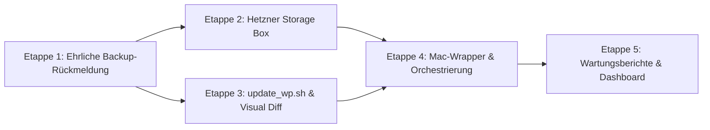

# Roadmap: WordPress Backup & Maintenance Toolchain #

Diese Roadmap definiert die strategische und technische Weiterentwicklung des bewährten Shell-Backup-Skripts `backup_full_db_files_zip.sh` zu einer schlanken, autarken und leicht zu wartenden Wartungs-Toolchain für WordPress-Kundeninstanzen auf Shared-Hosting-Servern.

---

## 1. Ausgangslage & Ist-Analyse

### 1.1 Script-Architektur & Komponenten
Die aktuelle Codebasis besteht aus zwei Hauptskripten sowie zugehörigen Konfigurations- und Protokollstrukturen:

1. **`backup_full_db_files_zip.sh` (v2.1.0, 2750 Zeilen):**
   - **Modularer Funktionsaufbau:**
     - *Hilfsfunktionen & Normalisierung:* `json_escape` (Z. 175), `json_string_array` (Z. 190), `get_file_size_bytes` (Z. 208), `normalize_scope` (Z. 227), `check_disk_space` (Z. 331), `resolve_dir_path` (Z. 369).
     - *Sicherheit & Webroot-Schutz:* `ensure_webroot_protection` (Z. 245) konfiguriert `.htaccess` für Apache 2.4 (`Require all denied`) und Apache 2.2 (`Deny from all`).
     - *Konfigurations- & WordPress-Parser:* `extract_wp_constant_sed` (Z. 394), `parse_wp_config_file` (Z. 408) liest DB-Parameter (`DB_NAME`, `DB_USER`, `DB_PASSWORD`, `DB_HOST`), Tabellenpräfix (`$table_prefix`) und Website-URLs tokenbasiert ohne PHP-Ausführung aus.
     - *Pre-Checks & Integrität:* `run_pre_backup_checks` (Z. 1382) validiert `WP_DEBUG`, PHP-Error-Logs, Upload-Verzeichnis auf Webshells/PHP-Dateien (unter Auslassung harmloser Index-Platzhalter) und DB-Konnektivität.
     - *Backup & Verifikation:* `backup_db` (Z. 2108), `backup_files` (Z. 2439) und `verify_backup` (Z. 2018) prüfen ZIP-Integrität (`unzip -tq`), SQL-Header/Footer (`mysqldump`, `-- Dump completed`), WordPress-Kerntabellen (`options`, `posts`) und 30%-Größenabweichungen.
     - *Wiederherstellung & Assistenten:* `interactive_restore_db` (Z. 1144), `run_interactive_wizard` (Z. 857), `scan_and_setup_wordpress_sites` (Z. 685), `run_main_menu` (Z. 1741).
   - **Konfigurationsmodell:**
     - Pro Projekt eine Konfigurationsdatei `.env.<projektname>` (Berechtigung `0600`), abwärtskompatibel zu `.env` ("default"). Unterstützt Multi-DB (`DB_COUNT`, `DB_1_*` bis `DB_n_*`), `SOURCE_FILES_DIR_IGNORE`, SFTP/Rsync-Fernübertragung und `DELETE_IF_TRANSMITTED`.
   - **Ablage- und Verzeichnisstruktur:**
     - Backups: `./backup/<PROJEKT_BASIS_DATEINAME>/`
     - Logs: `./log/<PROJEKT_BASIS_DATEINAME>_YYYY-MM-DD_HH-MM-SS.log`
     - Maschinenlesbarer Status: `./status/<PROJEKT_BASIS_DATEINAME>.last.json`

2. **`update_wp.sh` (v1.0.0, 2223 Zeilen):**
   - Autarkes Update-Skript mit WP-CLI-Integration (`./bin/wp-cli.phar` via `ensure_wp_cli`, SHA-512 Hash-Prüfung).
   - Projektkonfiguration `.update.<projekt>` mit Pre-Checks (Wartungsmodus, HTTP 200, `MUST_CONTAIN`), Backup-Pflicht-Kopplung an `backup_full_db_files_zip.sh`, visuellem Screenshot-Vergleich (Sitemap-Sampling via mshots/Local-Headless, Differenzberechnung via ImageMagick `compare` / PHP-GD) und Ampel-Bewertung (GRÜN, GELB, ROT) inkl. automatischer `rollback.sh`-Generierung.

---

### 1.2 Signal- und Fehlerbehandlung
- **Exitcode-Konvention (einheitlich 0, 1, 2):**
  - `0` (Erfolg / GRÜN): Alle Operationen (Dumps, ZIPs, Prüfungen, Übertragungen) fehlerfrei abgeschlossen.
  - `1` (Warnung / GELB): Nicht-kritische Fehler (z. B. Remote-Transfer fehlgeschlagen, lokales Backup jedoch intakt; Backup-Größenabweichung > 30 %; Antwortzeitverlangsamung; einzelne übersprungene Updates).
  - `2` (Fehler / ROT): Kritischer Ausfall (Datenbankdump fehlgeschlagen, ZIP-Erstellung defekt, Integritätsprüfung fehlgeschlagen, Vorprüfungen nicht bestanden).
- **Multi-Projekt-Lauf (`--project=alle`):**
  - Sequenzielle Abarbeitung aller Projekte; der schwerwiegendste Exitcode (`worst_exit_code`) bestimmt den finalen Skript-Exitcode.
- **Maschinenlesbare Schnittstelle (`--json`):**
  - Reines JSON-Objekt (bzw. JSON-Array bei `alle`) auf `stdout`, alle Benutzerhinweise, Fortschrittsmeldungen und Fehler auf `stderr`.
- **Historische & verbleibende Fehlerschluckstellen:**
  - *Behoben:* Früher ignoriertes Fehlen von `zip` oder stumme `mysqldump`-Abbrüche werden durch `verify_backup` und strenge Return-Code-Prüfung abgefangen.
  - *Identifiziertes Restrisiko:* Bei exotischen MySQL-Varianten oder Remote-Proxies können spezifische Fehlermeldungen in stderr auflaufen, ohne dass `mysqldump` einen ungleich-0 Exitcode setzt (abgefangen durch Header/Footer-Validierung).

---

### 1.3 Sicherheitsanalyse
- **Zugangsdaten & Dateirechte:**
  - `umask 077` am Skriptanfang erzwingt standardmäßig restriktive Rechte (`0700` für Ordner, `0600` für neu erzeugte Dateien).
  - `.env.*` und `.update.*` liegen mit `chmod 600` im Skriptverzeichnis.
  - Keine Klartext-Passwörter in Prozesslisten (`MYSQL_PWD` Umgebungsvariable wird verwendet).
- **Webroot-Schutz:**
  - Automatischer Schutz via `.htaccess` (`ensure_webroot_protection`) sperrt direkten Webzugriff auf Backup-, Log-, Status- und Update-Verzeichnisse sowie auf `.env`-, `.sh`- und `.log`-Dateien.
- **Verhalten von `DELETE_IF_TRANSMITTED`:**
  - Lokale Backups werden erst gelöscht, nachdem die Übertragung via `sftp` oder `rsync` fehlerfrei beendet und die Selbstprüfung erfolgreich durchlaufen wurde.
  - *Sicherheitslücke im Ist-Zustand:* Bei Nutzung eines gemeinsamen Remote-SFTP-Zugangs könnte ein kompromittierter Webserver bestehende Remote-Backups überschreiben oder löschen.

---

### 1.4 Technische Schulden & Risiken

| Komponente / Funktion | Zeilenbereich | Identifiziertes Risiko / Technische Schuld | Auswirkung & Gegenmaßnahme |
| :--- | :--- | :--- | :--- |
| `backup_full_db_files_zip.sh` (`backup_db`) | Z. 2124–2160 | `mysqldump` nutzt `--single-transaction`, sperrt aber bei Nicht-InnoDB-Tabellen (MyISAM) nicht konsistent. | MyISAM-Tabellen können inkonsistent gedumpt werden. Empfehlung: Hinweis/Warnung bei MyISAM-Tabellen in Pre-Checks. |
| `backup_full_db_files_zip.sh` (`DELETE_IF_TRANSMITTED`) | Z. 2570–2630 | Lokales Löschen nach SFTP-Upload ohne Verifikation von ZFS-Snapshots auf dem Zielserver. | Bei Ransomware auf dem Host könnten Remote-Dateien gelöscht werden. Lösung: Briefkasten-Prinzip & Storage-Box-Snapshots (Etappe 2). |
| `update_wp.sh` (`discover_sitemap_urls`) | Z. 969–1070 | Sitemap-Extraktion stützt sich auf XML-Regex/PHP-DOM. Sehr große Sitemaps (> 10.000 URLs) können Memory-Limits erreichen. | Paginierung oder Stream-Parsing bei Sitemap-Indizes sicherstellen. |
| `update_wp.sh` (`capture_screenshot`) | Z. 1072–1145 | `mshots` ist von externer Erreichbarkeit abhängig; bei IP-Schutz oder Basic-Auth schlägt Aufnahme fehl. | Sanfter Fallback auf HTTP-Status- und Log-Prüfung ohne Abbruch (Status GELB statt Abbruch). |
| Shared Codebase | Beide Skripte | Gewollte Autarkie führt zu duplizierten Hilfsfunktionen (`json_escape`, `get_file_size_bytes`, `ensure_webroot_protection`). | Bei Anpassungen müssen Änderungen synchron in beiden Skripten gepflegt werden (oder via Mac-Orchestrierung validiert werden). |

---

## 2. Leitlinien & Architekturprinzipien

1. **Mensch in der Schleife (Human-in-the-Loop):**
   - Der Administrator (Gregor) startet Wartungs- und Update-Prozesse gezielt interaktiv per SSH oder remote über Mac-CLI-Wrapper.
   - Alle nachgelagerten Prüfungen, Backups, Verifikationen und visuellen Diffs laufen vollautomatisch ab.
   - Bei Unregelmäßigkeiten oder Fehlern (Status GELB/ROT) greift der Administrator manuell ein; keine ungeprüften Zwangs-Rollbacks im Blindflug.
2. **Shared-Hosting-Tauglichkeit:**
   - Kein Root-Zugriff, kein `sudo`, keine Hintergrund-Daemons oder Docker-Container erforderlich.
   - Ausschließliche Nutzung portabler Standard-Werkzeuge (Bash 4+, `curl`/`wget`, `unzip`, `grep`, `sed`, `awk`, `find`, PHP-CLI).
3. **Einfache Verwaltung vor Überkomplexität (Self-Contained & KISS):**
   - Jedes Skript arbeitet vollständig autark ohne zwingende externe Laufzeitbibliotheken.
   - Keine komplexen Datenbank-Backends für Statusdaten; Speicherung in einfachen, inspizierbaren JSON- und Log-Dateien.
4. **Strikter Erhalt der Abwärtskompatibilität:**
   - Bestehende `.env.<projekt>`-Dateien, Verzeichnisstrukturen, Restore-Mechanismen und Cronjobs bleiben uneingeschränkt funktionsfähig.

---

## 3. Die 5 Etappen der Roadmap



---

### Etappe 1: Ehrliche Rückmeldung & Selbstprüfung des Backup-Scripts

#### Ziel & Nutzen
Verlässliche, automatisierte Erkennung von Backup-Erfolgen und -Fehlern ohne zeitraubende manuelle Log-Inspektion.

#### Aufgaben-Checkliste
- [x] **Explizite Exitcodes definieren und durchsetzen:**
  - `0`: Alle Dumps, ZIPs, Prüfungen und Übertragungen fehlerfrei abgeschlossen.
  - `1`: Warnungen (z. B. Remote-Transfer fehlgeschlagen bei intaktem lokalem Backup; Größenabweichung > 30 %).
  - `2`: Kritischer Fehler (DB-Dump fehlgeschlagen, ZIP defekt, Tabellen fehlen).
  - Multi-Projekt-Lauf (`--project=alle`): Sammeln aller Status und Rückgabe des schwerwiegendsten Fehlers (`worst_exit_code`).
- [x] **Funktion `verify_backup` implementieren:**
  - ZIP-Archivintegrität mit `unzip -tq` testen.
  - DB-Dump auf `mysqldump`-Header und `-- Dump completed`-Footer prüfen.
  - WordPress-Kerntabellen (`<prefix>options`, `<prefix>posts`) im SQL-Dump validieren.
  - Dateigrößenvergleich mit vorherigem Lauf desselben Projekts (Warnung bei > 30 % Abweichung).
  - Verifikationslauf zwingend *vor* einem optionalen lokalen Löschen (`DELETE_IF_TRANSMITTED`).
- [x] **Maschinenlesbare Statusdateien erzeugen:**
  - Nach jedem Lauf Ablage unter `./status/<PROJEKT_BASIS_DATEINAME>.last.json`.
  - JSON-Generierung portabel und sicher via `json_escape` ohne Abhängigkeit von `jq`.
  - Verzeichnis `./status/` mit `ensure_webroot_protection` absichern.
- [x] **CLI-Parameter `--json` und `--quiet` bereitstellen:**
  - `--json`: Reines Status-JSON auf `stdout` (Logs und Meldungen nach `stderr`).
  - `--quiet`: Reduzierte Ausgabe (nur Fehler und Abschlusszusammenfassung).
- [x] **Dokumentation & Hilfetexte aktualisieren:**
  - `--help` und Kopfkommentare um Exitcodes und neue Flags ergänzen.

#### Betroffene Dateien & Funktionen
- `backup_full_db_files_zip.sh`: `verify_backup`, `backup_db`, `backup_files`, `json_escape`, `get_file_size_bytes`, `run_pre_backup_checks`, Main-Loop.
- `README.md`, `CHANGELOG.md`.

#### Abnahmekriterien
1. Ein fehlerhafter DB-Dump oder defektes ZIP bricht reproduzierbar mit Exitcode `2` ab.
2. Ein fehlgeschlagener SFTP-Upload bei intakter lokaler Datei liefert Exitcode `1`.
3. `./status/<projekt>.last.json` ist syntaktisch valides JSON und enthält alle Ausführungsmetadaten.
4. Aufruf mit `--json` liefert ausschließlich parsebares JSON auf `stdout`.

#### Testplan & Fehlerfälle
- *Test 1 (Erfolgsfall):* Regulärer Backup-Lauf → Exitcode `0`, JSON-Status `"ok"`, alle Dateien `geprueft: true`.
- *Test 2 (DB-Dump-Fehler):* Falsches DB-Passwort provizieren → Exitcode `2`, JSON-Status `"fehler"`.
- *Test 3 (Remote-Transfer-Fehler):* Ungültigen SFTP-Host konfigurieren → Exitcode `1`, lokales Backup bleibt erhalten.
- *Test 4 (Strukturfehler):* Manipulierter DB-Dump ohne `wp_posts` → `verify_backup` meldet Fehler, Exitcode `2`.
- *Test 5 (Cron-/Headless-Aufruf):* Ausführung via Cronjob ohne TTY → läuft ohne Eingabeaufforderung durch.

#### Risiken & Abwärtskompatibilität
- *Cronjob-Mails:* Bei Exitcode `1` oder `2` können Cron-Daemons Status-Mails versenden (gewolltes Verhalten zur Fehlerfrühwarnung).
- *Abhängigkeiten:* Erfordert `unzip` auf dem Host für `unzip -tq` (Fallback vorhanden).

#### Aufwandsschätzung
**M** (Bereits prototypisch in der Codebasis verankert und abgenommen).

---

### Etappe 2: Sichere Ablage auf Hetzner Storage Box (Briefkasten-Prinzip)

#### Ziel & Nutzen
Isolierte, manipulationssichere Offsite-Sicherung pro Kunde/Projekt auf Hetzner Storage Boxen mit ZFS-Snapshot-Schutz gegen Löschung und Ransomware.

#### Aufgaben-Checkliste
- [ ] **Sicherheitskonzept für Storage-Box-Unterkonten umsetzen:**
  - Verwendung dedizierter Unterkonten pro Projekt/Kunde (kein Hauptaccount-Zugriff vom Webserver).
  - Begrenzung der Zugriffsrechte des Unterkontos auf das projekteigene Verzeichnis.
- [ ] **Setup-Assistenten um SSH-Key-Generierung erweitern:**
  - Automatische Erzeugung eines dedizierten ed25519-Schlüsselpaars pro Projekt (`ssh-keygen -t ed25519 -N "" -C "backup-<projekt>@<server>"`).
  - Speicherung mit `chmod 600` in einem geschützten Verzeichnis (vorzugsweise außerhalb des Webroots oder unter `./keys/`).
  - Anzeige des Public Keys im Terminal mit genauer Anleitung zum Hinterlegen in den `authorized_keys` des Storage-Box-Unterkontos.
  - Hinweis auf Hetzner Storage Box Port `23` und OpenSSH-Format.
- [ ] **Automatisierter Verbindungstest im Setup-Assistenten:**
  - Testverbindung via SFTP/SSH auf Port 23 durchführen.
  - Validierung von Schreibrechten im Zielverzeichnis.
- [ ] **ZFS-Snapshot-Schutz & Dokumentation:**
  - Dokumentation zur Aktivierung automatischer täglicher Snapshots in der Hetzner Robot/Cloud Console.
  - Anleitung zur granularen Dateiwiederherstellung aus dem schreibgeschützten Verzeichnis `/.zfs/snapshot/` (kein vollständiger Storage-Box-Rollback erforderlich).
- [ ] **Absicherung von `DELETE_IF_TRANSMITTED`:**
  - Deutliche Warnmeldung im Setup und Log, falls `DELETE_IF_TRANSMITTED="yes"` konfiguriert ist, ohne dass ZFS-Snapshots bestätigt wurden.
- [ ] **Migrations-Leitfaden für bestehende Projekte:**
  - Schritt-für-Schritt-Anleitung zur Überführung bestehender `.env`-Dateien mit Hauptaccount-Zugangsdaten auf isolierte Unterkonten.

#### Betroffene Dateien & Funktionen
- `backup_full_db_files_zip.sh`: `run_interactive_wizard`, `test_remote_connection`, `setup_ssh_key_storage_box`.
- `.env.example`, `README.md`.

#### Abnahmekriterien
1. Der Setup-Assistent generiert auf Knopfdruck funktionierende ed25519-Schlüssel und testet die Verbindung zu Port 23 der Storage Box.
2. Ein kompromittierter Webserver kann über das Unterkonto ausschließlich seine eigenen Backups manipulieren, jedoch weder Backups anderer Kunden einsehen noch historische ZFS-Snapshots löschen.
3. Die Dokumentation erklärt verständlich die Konfiguration von Snapshots und die Dateiwiederherstellung aus `/.zfs/snapshot`.

#### Testplan & Fehlerfälle
- *Test 1 (Key-Erzeugung):* Erstellen eines neuen Projekts mit Storage Box → ed25519-Key wird mit `0600` erstellt.
- *Test 2 (Verbindungstest OK):* Verbindung zur konfigurierten Storage Box mit gültigem Key erfolgreich.
- *Test 3 (Verbindungstest Fehler):* Ungültiger Port/Key wird abgefangen, Assistent gibt korrigierende Hinweise.
- *Test 4 (Upload & Snapshot-Prüfung):* Testdatei hochladen und Sichtbarkeit im Snapshot-Pfad `/.zfs/snapshot/` verifizieren.

#### Risiken & Abwärtskompatibilität
- *Hetzner-Restriktionen:* Storage Boxen unterstützen nur Port 23 für SFTP/SSH-Key-Authentifizierung.
- *Abwärtskompatibilität:* Bestehende Zugangsdaten mit Passwort oder Rsync bleiben weiterhin voll funktionsfähig.

#### Aufwandsschätzung
**M** (Erweiterung des Setup-Wizards und Erstellung der Dokumentation).

---

### Etappe 3: WordPress-Update-Script `update_wp.sh` & Visuelle Regression

#### Ziel & Nutzen
Risikolose, automatisierte WordPress-Aktualisierungen mit vorgeschaltetem Backup-Schutz, visueller Differenzprüfung und sofort verfügbarem Rollback-Plan.

#### Aufgaben-Checkliste
- [x] **Autarkes Skript `update_wp.sh` bereitstellen:**
  - Selbstinstallation von WP-CLI nach `./bin/wp-cli.phar` mit SHA-512-Hashvalidierung.
  - Parameter `--update-wpcli` zur Aktualisierung der Phar-Datei.
- [x] **Projektkonfiguration `.update.<projekt>` etablieren:**
  - Setup-Assistent zur Erzeugung von Konfigurationen aus vorhandenen `.env`-Dateien.
  - Parameter: `WP_PATH`, `SITE_URL`, `MUST_CONTAIN`, `CHECK_PATHS`, `SKIP_PLUGINS`, `BACKUP_MAX_AGE_MIN`, `RUN_BACKUP_FIRST`, `ENABLE_SCREENSHOTS`, `SCREENSHOT_PAGES_COUNT`, `SCREENSHOT_METHOD`.
- [x] **Robuste Vorprüfungen implementieren:**
  - `wp core is-installed`, Wartungsmodus-Check.
  - HTTP-Status 200 und Vorhandensein von `MUST_CONTAIN` auf Startseite und allen `CHECK_PATHS`.
  - Bei Vorprüfungs-Fehler: Sofortiger Abbruch mit ROT ("schon vorher defekt"), keine Änderungen.
- [x] **Backup-Vorschalt-Schritt erzwingen:**
  - Aufruf von `backup_full_db_files_zip.sh --project=<name> --scope=alles --json`.
  - Fortfahren nur bei Exitcode `0` oder Exitcode `1` mit `geprueft: true`.
  - Bei `RUN_BACKUP_FIRST=no`: Prüfung auf valides `.last.json` jünger als `BACKUP_MAX_AGE_MIN`.
- [x] **Stand-Sicherung vor Update erfassen:**
  - Speicherung in `update-runs/<projekt>/<zeitstempel>/`.
  - WP-Core-Version, `wp plugin list --format=json`, `wp theme list --format=json`, Error-Log Zeilenzahlen, HTTP-Latenzen.
- [x] **Visuelle Regressionsprüfung integrieren:**
  - Sitemap-Erkennung (`wp-sitemap.xml`, `sitemap_index.xml`) und URL-Sampling (`discover_sitemap_urls`).
  - Vorher/Nachher-Screenshots via Automattic `mshots` API oder lokalen Headless-Browser (`capture_screenshot`).
  - Differenzbild-Erstellung (`diff.png`) und prozentuale Abweichungsberechnung via ImageMagick `compare` oder PHP-GD (`compare_screenshots`).
  - Bewertung: $< 5\,\%$ GRÜN, $5-20\,\%$ GELB, $> 20\,\%$ ROT.
- [x] **Updates sequenziell ausführen & protokollieren:**
  - `wp core update`, `wp core update-db`, `wp plugin update --all --exclude=...`, `wp theme update --all`, `wp language ... update --all`, `wp cache flush`.
- [x] **Nachprüfung & Differenzanalyse:**
  - `wp core verify-checksums` (unter `--skip-plugins --skip-themes`).
  - Komponenten-Diff (Name, vorherige Version, aktualisierte Version).
  - Error-Log-Analyse (Zählung von Fatal Errors und Speicherung der letzten 20 neuen Zeilen).
  - HTTP-Nachprüfung aller Testpfade (Status 200, `MUST_CONTAIN`, Abwesenheit kritischer Fehlertexte, Latenzvergleich).
- [x] **Ampelsystem, Rollback & JSON-Export:**
  - Ampel: GRÜN (alles ok), GELB (Warnungen/Latenzanstieg/Diff), ROT (kritischer Fehler/Checksummen falsch/HTTP ≠ 200).
  - Erstellung von `rollback.sh` mit gezielten Down-Pins (`wp plugin install <slug> --version=<alt> --force`).
  - Strukturierter JSON-Export auf `stdout` (Logs auf `stderr`).
  - Automatische Bereinigung alter Run-Verzeichnisse (> 90 Tage).

#### Betroffene Dateien & Funktionen
- `update_wp.sh`: Gesamtes Skript (Setup, Pre-Checks, Screenshot-Diff, Update-Pipeline, Rollback-Generator).
- `.update.example`, `README.md`, `CHANGELOG.md`.

#### Abnahmekriterien
1. Schlägt das vorgeschaltete Backup fehl, wird kein WP-CLI-Update ausgeführt.
2. Ein simulierter Layout-Bruch oder PHP Fatal Error führt verlässlich zu Ampel ROT und einem funktionsfähigen `rollback.sh`.
3. Bei fehlerfreiem Durchlauf liefert `update_wp.sh` Exitcode `0`, Ampel GRÜN und valides JSON.

#### Testplan & Fehlerfälle
- *Test 1 (Fehlerfreies Update):* Standard-Update aller Komponenten → GRÜN, Exitcode `0`, Diff protokolliert.
- *Test 2 (Fehlgeschlagenes Backup):* DB-Zugang sperren → Update bricht vor Änderungen mit ROT ab.
- *Test 3 (Visueller Fehler / Broken Layout):* CSS verändern → Differenz $> 20\,\%$ führt zu GELB/ROT, `diff.png` zeigt Abweichung.
- *Test 4 (Dry-Run):* Aufruf mit `--dry-run` listet verfügbare Updates auf, führt keine Änderungen durch.
- *Test 5 (Automatisierter Lauf):* Aufruf via SSH `ssh user@host 'update_wp.sh --project=kundeA --json'` gibt sauberes JSON zurück.

#### Risiken & Abwärtskompatibilität
- *Externe APIs:* `mshots` benötigt öffentlichen Internetzugriff. Bei geschützten Staging-Systemen greift der Fallback auf reine HTTP- und Log-Prüfung.
- *Server-Ressourcen:* Bildvergleiche auf Shared Hosting optimiert (sparsames 2-Pixel-Raster bei PHP-GD).

#### Aufwandsschätzung
**L** (Vollständig implementiert und getestet).

---

### Etappe 4: Prüfung von außen (Mac-Wrapper-Script & Orchestrierung)

#### Ziel & Nutzen
Bequeme, parallele oder sequentielle Ausführung und visuelle Validierung von Wartungsläufen über alle Kundeninstanzen hinweg direkt vom lokalen macOS-Entwicklerrechner.

#### Aufgaben-Checkliste
- [ ] **Lokales Mac-Orchestrierungsskript entwickeln (`mac/wp_maintain.sh` oder `tools/remote_update.sh`):**
  - Liest eine lokale Inventarliste aller Kunden und Server.
  - Bietet interaktive Projekt-Auswahl oder Durchlauf für `--all`.
  - Unterstützt `--dry-run`, `--check`, `--update`, `--json`.
- [ ] **Kunden-Inventarstruktur etablieren (`tools/clients.json`):**
  - Vorlage `clients.example.json` bereitstellen:
    ```json
    [
      {
        "id": "kundeA",
        "ssh_host": "ssh.kunde-a.de",
        "ssh_user": "u12345",
        "ssh_port": 22,
        "remote_dir": "/var/www/vhosts/kundeA/backup",
        "site_url": "https://www.kunde-a.de"
      }
    ]
    ```
- [ ] **SSH-Fernsteuerung mit JSON-Pipeline:**
  - Ausführung per SSH: `ssh -p <port> <user>@<host> 'cd <remote_dir> && ./update_wp.sh --project=<id> --json'`.
  - Parsen des JSON-Rückgabewerts auf dem Mac zur Erfassung von Status, Fehlern und Diff-Metadaten.
- [ ] **Lokale visuelle Zweitprüfung (Mac Playwright / BackstopJS):**
  - Optionaler lokaler Screenshot-Vergleich im echten Headless-Chromium auf dem Mac (unabhängig von Server-Ressourcen und ohne Abhängigkeit von `mshots`).
  - Pixel-genaue Differenzanalyse und Speicherung lokaler HTML-Prüfberichte.
- [ ] **Farbige Zusammenfassungsmatrix im Terminal:**
  - Übersichtliche Terminaltabelle am Ende des Gesamtlaufs:
    - Kunde / Domain
    - Backup-Status (OK / Warnung / Fehler)
    - Update-Ampel (GRÜN / GELB / ROT)
    - Anzahl aktualisierter Plugins/Themes
    - Visuelle Differenz (%)
    - Rollback-Pfad bei Fehlern

#### Betroffene Dateien & Funktionen
- `mac/wp_maintain.sh` (oder `tools/remote_update.sh`).
- `tools/clients.example.json`, `tools/package.json` (falls Playwright genutzt wird).
- `README.md`, `CHANGELOG.md`.

#### Abnahmekriterien
1. Ein Aufruf von `./mac/wp_maintain.sh --all` iteriert über alle konfigurierten Kunden, führt die Remoteskripte aus und fängt Verbindungsabbrüche isoliert ab.
2. Das Terminal zeigt eine strukturierte Übersicht mit Ampelfarben und klaren Handlungsempfehlungen bei Fehlern.
3. Lokale Screenshot-Prüfungen decken Layout-Fehler auf, selbst wenn auf dem Server keine Bildverarbeitungstools installiert sind.

#### Testplan & Fehlerfälle
- *Test 1 (Single Project Remote):* Ein einzelnes Kundenprojekt vom Mac aus aktualisieren → Rückgabe des Remote-JSON und Anzeige der Erfolgsmatrix.
- *Test 2 (SSH-Verbindungsfehler):* Unerreichbaren SSH-Host simulieren → Skript markiert Kunden als ROT/Unerreichbar und fährt mit nächsten Kunden fort.
- *Test 3 (Fehlerbehandlung bei Remote-Abbruch):* Remote-Skript meldet Fehler (Exit 2) → Mac-Skript zeigt detaillierte Fehlerursache und Rollback-Befehle an.
- *Test 4 (Dry-Run über alle Kunden):* Ermittelt bei allen Kunden gleichzeitig anstehende Updates ohne Änderungen.

#### Risiken & Abwärtskompatibilität
- *SSH-Key-Verwaltung:* Erfordert hinterlegte SSH-Keys im lokalen SSH-Agenten (`ssh-add`).
- *Netzwerk-Timeouts:* Robuste Timeout-Behandlung für langsame Kunden-Server erforderlich.

#### Aufwandsschätzung
**M** (Eigenständiges Mac-Skript und JSON-Aggregator).

---

### Etappe 5: Multi-Projekt-Dashboard & Kunden-Wartungsberichte

#### Ziel & Nutzen
Automatisierte Erstellung transparenter Monatsberichte für Kunden sowie eine übersichtliche, statische Statusübersicht aller betreuten Instanzen für das interne Monitoring.

#### Aufgaben-Checkliste
- [ ] **Berichts- & Dashboard-Generator erstellen (`tools/generate_report.sh`):**
  - Liest die gesammelten `.last.json`-Dateien und `update-runs/`-Metadaten aller Projekte ein.
  - Erzeugt statische, performante HTML- und Markdown-Dokumente ohne Datenbank-Backend.
- [ ] **Internes Multi-Projekt-Dashboard:**
  - Übersicht aller Kunden: Backup-Datum, Backup-Größe, WordPress-Version, Plugin-Status, offene Sicherheitswarnungen, PHP-Version.
  - Ampel-Status-Filter (z. B. "Zeige alle Installationen mit Status GELB/ROT").
- [ ] **Vorlage für monatliche Kunden-Wartungsberichte:**
  - Vorlage `templates/report_monthly.md` bzw. `templates/report_monthly.html`.
  - Strukturierte Abschnitte für Kunden:
    - Zusammenfassung des Systemzustands
    - Aktualisierte Komponenten (Core, Plugins, Themes) mit Vorher-/Nachher-Versionsnummern
    - Durchgeführte Sicherheits- und Integritätsprüfungen
    - Bestätigung der externen Offsite-Sicherung
- [ ] **Automatisierter Export:**
  - Export als Markdown (für direkte E-Mail-Benachrichtigungen) und optional als HTML/PDF.

#### Betroffene Dateien & Funktionen
- `tools/generate_report.sh`
- `templates/dashboard.html`, `templates/report_monthly.md`
- `README.md`, `CHANGELOG.md`.

#### Abnahmekriterien
1. Auf Knopfdruck wird ein vollständiger Monatsbericht pro Kunde generiert, der alle durchgeführten Updates und Backup-Stati übersichtlich zusammenfasst.
2. Das statische HTML-Dashboard lässt sich lokal im Browser öffnen und zeigt den aktuellen Sicherheits- und Wartungszustand aller Projekte.

#### Testplan & Fehlerfälle
- *Test 1 (Berichtsgenerierung):* Ausführen von `generate_report.sh` mit Test-JSON-Dateien → Erzeugt saubere Markdown- und HTML-Dateien.
- *Test 2 (Fehlende Statusdaten):* Projekt ohne bisherige Update-Läufe wird im Dashboard als "Noch nicht gewartet" markiert, ohne den Generator zu unterbrechen.
- *Test 3 (Diff-Visualisierung):* Aktualisierte Plugins werden mit Versionssprüngen (z. B. "WooCommerce 8.5.1 → 8.6.0") korrekt aufgeführt.

#### Risiken & Abwärtskompatibilität
- *Keine Systemauswirkungen:* Reine Lese- und Aggregationswerkzeuge ohne Eingriff in laufende Kundenserver.

#### Aufwandsschätzung
**S** (Template-Design und Auswertungsskript).

---

## 4. Rollout- & Betriebsstrategie

### 4.1 Versionsverwaltung & Changelog
- **Semantische Versionierung (SemVer):**
  - Skripte tragen im Kopfkommentar eine Versionskonstante (`VERSION="X.Y.Z"`).
  - Versionen:
    - *Major (X.0.0):* Breaking Changes an Konfigurationsformaten (`.env`, `.update`) oder grundlegender Verzeichnisstruktur.
    - *Minor (X.Y.0):* Neue Funktionen, Prüfungen oder CLI-Optionen (vollständig abwärtskompatibel).
    - *Patch (X.Y.Z):* Bugfixes, Logging-Verbesserungen, Sicherheitsoptimierungen.
- **Zentrale Dokumentation:**
  - Alle Änderungen werden verbindlich in `CHANGELOG.md` im "Keep a Changelog"-Format dokumentiert.

### 4.2 Bereitstellung auf Kundenservern
- **3-Schritte-Standard-Bereitstellung für neue Instanzen:**
  1. Skript-Dateien (`backup_full_db_files_zip.sh`, `update_wp.sh`) in das Kundenverzeichnis (z. B. `backup/`) hochladen.
  2. `./backup_full_db_files_zip.sh --scan-wp` ausführen (erkennt WordPress automatisch und legt `.env.<projekt>` an).
  3. `./update_wp.sh --setup` ausführen (initialisiert WP-CLI und legt `.update.<projekt>` an).
- **Zentralisiertes Update bestehender Server (über Etappe 4):**
  - Das Mac-Wrapper-Script kann mit einem Flag `--deploy-scripts` die aktuellen Skriptversionen per SFTP/Rsync synchron auf alle konfigurierten Kundenserver verteilen.

### 4.3 Versionsprüfung bei Laufzeitstart
- Beim Start prüfen die Skripte optional ihre Version und geben bei gravierenden Versionsunterschieden zwischen Backup- und Update-Skript eine Warnung aus.

---

## 5. Offene Entscheidungen & Fragen vor den Etappen

| Thema | Offene Frage | Handlungsoptionen | Empfehlung / Tendenz |
| :--- | :--- | :--- | :--- |
| **Storage Box Provisionierung (Etappe 2)** | Wie werden Unterkonten bei Hetzner angelegt? | A: Manuell im Hetzner Robot / Cloud Console.<br>B: Automatisiert über Hetzner Robot WebService API. | **Option A** für Start (einfach, keine API-Token auf dem Webserver nötig). Optional später CLI-Helper für den Mac. |
| **SSH-Port & Hostkeys (Etappe 2)** | Wie wird der SSH-Hostkey der Storage Box verifiziert? | A: Interaktive Bestätigung beim Setup (`ssh -p 23`).<br>B: Vorkonfigurierte `known_hosts`-Einträge für Hetzner Storage Boxen. | **Option A** mit Speicherung in projekteigenem `known_hosts`-File. |
| **Mac-Tooling (Etappe 4)** | Welcher Tech-Stack für das Mac-Wrapper-Skript? | A: Reines Bash-Skript mit `curl` und `ssh`.<br>B: Node.js / TypeScript CLI mit Playwright-Integration. | **Option A** als Kern (läuft out-of-the-box auf jedem Mac), optional Node/Playwright als visuelles Add-on. |
| **Berichts-Ausgabe (Etappe 5)** | Welches Zielformat für monatliche Kundenberichte? | A: Markdown für formatierte E-Mails.<br>B: Statisches responsive HTML.<br>C: PDF-Generierung via Headless Chrome. | **Option A & B** kombinieren (HTML-Dashboard für Web, Markdown für direkten Mailversand). |

---

## 6. Nicht im Umfang (Out of Scope)

Die folgenden Architekturen und Ansätze wurden bewusst ausgeschlossen, um die Wartungs-Toolchain schlank, robust und ohne unnötige Betriebskosten zu halten:

1. **Zentraler Kontrollserver / Web-SaaS-Plattform:**
   - *Begründung:* Ein zentraler Webserver mit Schreibzugriff auf alle Kundenserver stellt ein enormes Sicherheitsrisiko (Single Point of Compromise) dar und erfordert laufende Serverwartung. Der "Mensch-in-der-Schleife"-Ansatz vom lokalen Mac aus ist sicherer und wartungsärmer.
   - *Neubewertung ab:* $> 100$ parallel betreuten WordPress-Kundeninstanzen.
2. **Asynchrone Message-Queues (RabbitMQ, Redis, Celery):**
   - *Begründung:* Völlig überdimensioniert für zeitgesteuerte oder manuelle Wartungsläufe. Synchrone SSH-Ausführung mit klaren Exitcodes liefert direktes Feedback.
   - *Neubewertung:* Nicht vorgesehen.
3. **Ende-zu-Ende-Verschlüsselung mit `age` / GPG vor dem Upload:**
   - *Begründung:* Erhöht die Komplexität und das Risiko von Datenverlust bei Schlüsselverlust erheblich. Zudem verhindert clientseitige Verschlüsselung die ZFS-Deduplizierung auf der Storage Box. Hetzner Storage Boxen bieten verschlüsselte Übertragung (SFTP/SSH) und serverseitige Verschlüsselung im Rechenzentrum.
   - *Neubewertung bei:* Strengen Kundenanforderungen mit expliziter Zero-Knowledge-Vorgabe.
4. **Vollautomatische unbeaufsichtigte Core-Major-Updates ohne Administrator-Freigabe:**
   - *Begründung:* Major-Updates von WordPress (z. B. 6.x auf 7.0) sowie Breaking Changes in Plugins (z. B. WooCommerce) erfordern immer menschliche Freigabe.
   - *Neubewertung:* Nicht vorgesehen (Mensch bleibt in der Schleife).
